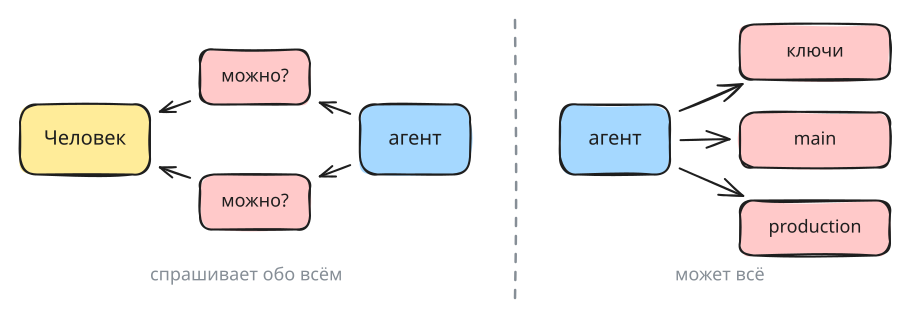
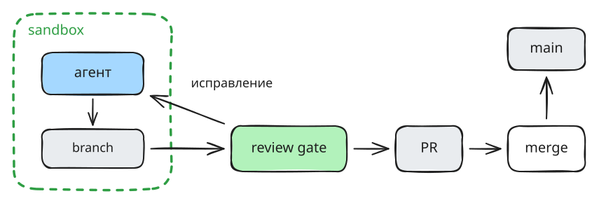
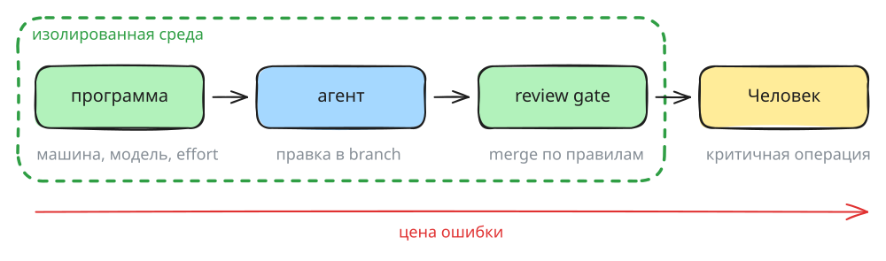
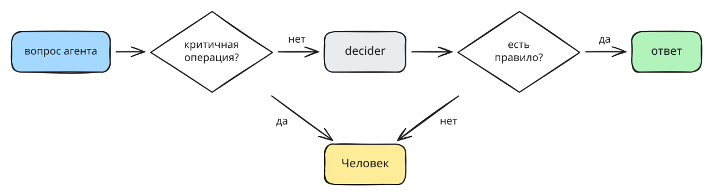

# Автономия и контроль

Агент, который спрашивает разрешение на каждую команду, работает не быстрее меня.
Агент, которому разрешено всё, однажды выполнит команду, которую нельзя отменить.
Я не выбираю между ними: сколько агент делает сам, задаёт цена его ошибки, а границу держит программа.

## Проблема

Посмотрите на эту картинку, она ещё понадобится.

*Схема 1: у агента два режима, и в одном он спрашивает обо всём, а в другом может всё.*

Я запускаю агента с подтверждением каждой команды.
Запросы идут один за другим, и скоро я одобряю их не читая, поэтому подтверждение больше ничего не защищает.
Тогда я снимаю подтверждения, и агент работает без остановок.
Теперь ему доступно всё, что доступно мне: ключи, main и production.
Одна неверная команда, и ошибку уже не вернуть.

Оба режима отвечают на вопрос, доверяю ли я агенту.
Я задаю другой вопрос: что будет, если агент ошибётся.
Дальше по ответу на него я делю правую половину картинки на части.

## Принципы

### Граница

Сначала я отделяю то, что агенту можно без вопросов.

**Автономию задаёт цена ошибки, а не доверие к агенту.**
Одна настройка доверия на все действия тормозит безопасные или пропускает опасные.
Поэтому о каждом действии я спрашиваю, можно ли его отменить и когда ошибка станет заметна.
Правка в branch исчезает вместе с branch, а release, удалённые данные и отправленное письмо назад не возвращаются.

**Внутри sandbox агент не спрашивает разрешения.**
Запрос на каждую команду приучает одобрять не читая.
Поэтому границу держит sandbox: агенту видны worktree задачи и нужная ей сеть, а ключей, main и production для него нет.
Всё, что агент сделал внутри, можно выбросить вместе с branch, поэтому спрашивать ему не о чем.

*Схема 2: рамка sandbox делит правую половину первой картинки, и внутри неё агент работает без вопросов.*

**Границу держит программа, а не инструкция.**
Запрет из инструкции действует, пока модель его помнит и пока в её контекст не попал текст с обратным указанием.
Поэтому запрет я выражаю правами: у агента нет доступа, который не нужен задаче, и вместо напоминания он получает отказ.
Подтверждение человека не заменяет ограничения прав: команда, одобренная по привычке, выполняется с полным доступом.

### Выход

Изменение не может остаться в sandbox: его нужно принять в main.

**Из sandbox изменение выходит только через review gate.**
Агент пишет «готово», когда закончил писать, и его слово не отличает проверенное изменение от непроверенного.
Поэтому между branch и PR стоит review gate: локальные проверки, ревью моделью другого семейства и CI.
Замечание возвращается агенту, он исправляет его без меня, и до PR доходит только изменение, которое прошло всё.

*Схема 3: у рамки sandbox появился один выход, и на нём стоит review gate.*

**Агент не принимает собственное изменение.**
Автор, который сам делает merge, сам себя и проверяет.
Поэтому merge делаю я или программа по правилам проекта, и она принимает только зелёный PR и ровно тот коммит, который проверен.
Merge можно отменить, поэтому правила проекта могут разрешить его без меня.

**Чем дороже ошибка, тем ближе решение к человеку.**
Действия делятся на три группы.
То, что можно выбросить, агент делает сам, а то, что можно отменить, проходит review gate.
То, что отменить нельзя, ждёт меня.

*Схема 4: чем дороже ошибка, тем дальше решение от агента: сначала review gate, потом человек.*

### Человек

Ключи и production с первой картинки так и остались снаружи.

**Критичные и рискованные операции ждут человека.**
Ревью после необратимой операции уже ничего не предотвращает.
К таким операциям относится то, что нельзя отменить, что тратит деньги, что даёт доступ и что становится публичным.
Агент готовит операцию до последнего шага и показывает, что изменится, а решение я принимаю до неё, а не по логу после.

**Агент спрашивает вместо догадки, а молчание не считается согласием.**
Агент, которому не хватает решения, принимает его сам, и я узнаю об этом из готового PR.
Поэтому вопрос считается обычным исходом работы: агент останавливается, называет варианты и ждёт ответа.
Рутинный вопрос закрывает decider, малая модель, которая отвечает по моим записанным правилам.
Что считать критичным, решает список в коде, а не модель, и вопрос из этого списка идёт сразу ко мне.

*Схема 5: рутинный вопрос закрывает decider, а критичную операцию и вопрос без правила получает человек.*

**Повторный сбой останавливает агента.**
Агент, у которого команда падает раз за разом, повторяет её и тратит лимит.
Причина часто не в команде, а в задаче: не хватает данных, или критерий готовности проверяет не тот результат.
Поэтому после нескольких одинаковых сбоев программа ставит работу на паузу и задаёт вопрос мне.

Сравните это с первой картинкой.
Там был один переключатель: спрашивать обо всём или разрешить всё.
Здесь агент работает без вопросов внутри sandbox, выходит из него через review gate, а я решаю то, что нельзя отменить.

## Как это устроено в Orc

Orc это мой оркестратор с открытым кодом, и эти границы в нём держит код.
Схема ниже собирает все картинки статьи в одну.

*Схема 6: агент свободен внутри sandbox, а наружу ведут два пути, review gate и attention queue.*

## Ресурсы

- [Где Orc останавливает агента](https://avi2d.github.io/agent-practice/blog/autonomy-orc.html): интерактивная версия схемы 6
- [Orc](https://github.com/avi2d/orc): исходный код моего оркестратора
- [Документация Orc](https://avi2d.github.io/orc/): устройство run, проверок, attention queue и merge
- [Оркестрация агентов](orchestration.md): как устроены очередь задач, запуск и проверка
- [Выбранные тезисы](theses.md): перечень тезисов всех статей
