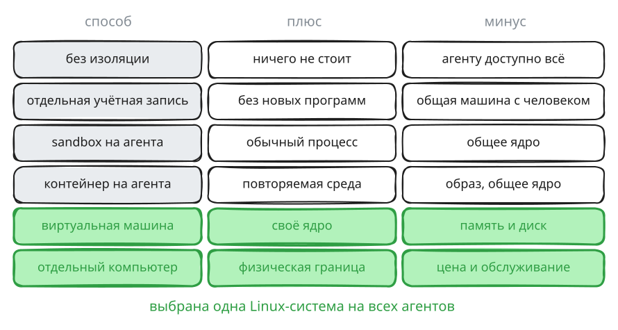
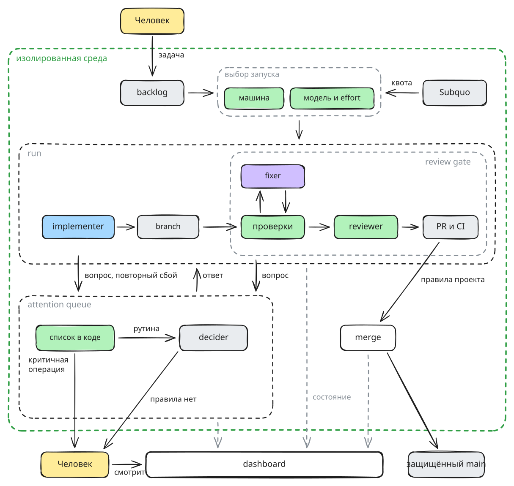

# Автономия и контроль

Агент, который спрашивает разрешение на каждую команду, работает не быстрее человека.
Агент, которому разрешено всё, однажды выполнит команду, которую нельзя отменить.
Выбирать между ними не нужно: сколько агент делает сам, задаёт цена его ошибки, а границу держит программа.

## Проблема

Посмотрите на эту картинку, она ещё понадобится.

*Схема 1: у агента два режима, и в одном он спрашивает обо всём, а в другом может всё.*

Агента запускают с подтверждением каждой команды.
Запросы идут один за другим, и скоро человек одобряет их не читая, поэтому подтверждение больше ничего не защищает.
Тогда подтверждения снимают, и агент работает без остановок.
Теперь ему доступно всё, что доступно человеку: ключи, main и production.
Одна неверная команда, и ошибку уже не вернуть.

Оба режима отвечают на вопрос, можно ли доверять агенту.
Полезнее другой вопрос: что будет, если агент ошибётся.
Ответ на него делит правую половину картинки на части.

## Принципы

### Граница

Первая часть это то, что агенту можно без вопросов.

**Автономию задаёт цена ошибки, а не доверие к агенту.**
Одна настройка доверия на все действия тормозит безопасные или пропускает опасные.
Поэтому о каждом действии задают два вопроса: можно ли его отменить и когда ошибка станет заметна.
Правку в branch можно выбросить, а необратимую операцию вернуть нельзя.

**Внутри изолированной среды агент не спрашивает разрешения.**
Запрос на каждую команду приучает одобрять не читая.
Поэтому границу держит изолированная среда: вся система агентов работает в отдельной Linux-системе без прав администратора и без доступа к диску машины человека, а ключей человека, main и production в ней нет.
Каждую правку файлов можно выбросить вместе с branch, а push в main и правку настроек CI токен агентов не пропускает, поэтому разрешение агенту не нужно.

*Схема 2: одна рамка изолированной среды обводит всю систему агентов, и внутри неё агент работает без запросов разрешения.*

Ту же границу можно провести иначе: отдельной учётной записью, sandbox или контейнером вокруг каждого агента, виртуальной машиной или отдельным компьютером.
Отдельная учётная запись закрывает агенту чужие файлы, но агент остаётся на одной машине с человеком.
Sandbox и контейнер делят ядро с машиной человека, а настройку получает каждый агент отдельно.
Изоляция, которая занимает память и диск на каждого агента, ограничивает число задач, идущих одновременно.
Поэтому граница одна на всю систему агентов: отдельная Linux-система на виртуальной машине или на отдельном компьютере, со своим ядром и пределом памяти и процессора на каждую задачу.
Sandbox вокруг одного агента остаётся возможностью для отдельной задачи, а границей считается изолированная среда.

*Схема 3: у каждого способа изоляции своя цена, а выбрана одна отдельная Linux-система на всю систему агентов, потому что у неё своё ядро и платить за неё нужно один раз.*

### Выход

Изменение не может остаться в изолированной среде: его нужно принять в main.
Наружу оно выходит через review gate: локальные проверки, независимое ревью и CI на открытом PR до merge.
Через review gate идёт каждое изменение, поэтому медленная проверка в нём задерживает всех агентов сразу, и её ускоряют без потери строгости.

**Чем дороже ошибка, тем ближе решение к человеку.**
Ошибку в выборе машины, модели или reasoning effort исправляет перезапуск, поэтому запуск выбирает программа, а не человек.
Правку в branch агент делает сам, потому что её можно выбросить, а merge зелёного PR идёт по правилам проекта, потому что его можно отменить.
То, что отменить нельзя, ждёт человека.

*Схема 4: запуск и правка идут без человека, merge зелёного PR решают правила проекта, а критичные и рискованные операции ждут человека.*

### Человек

Ключи и production с первой картинки так и остались снаружи.

**Критичные и рискованные операции ждут человека.**
Ревью после необратимой операции уже ничего не предотвращает.
Пройденные проверки не дают агенту права выполнить такую операцию.
Агент готовит операцию до последнего шага и показывает, что изменится, а человек решает до неё, а не по логу после.

**Что считать критичным, решает список в коде, а не модель.**
Модель, которая сама отличает рутинный вопрос от критичного, однажды ответит на критичный.
Поэтому программа сверяет каждый вопрос со списком критичных и рискованных операций: вопрос из списка идёт сразу к человеку, а остальные получает decider, малая модель.
Decider отвечает только по правилам проекта и вопрос без правила передаёт человеку, а молчание человека не считается согласием.

*Схема 5: до человека доходят критичные и рискованные операции из списка в коде и вопросы без правила, а остальные вопросы закрывает decider по правилам проекта.*

**Повторный сбой останавливает агента.**
Агент, у которого команда падает раз за разом, повторяет её и тратит лимит.
Причина часто не в команде, а в задаче: не хватает данных, или критерий готовности проверяет не тот результат.
Поэтому после нескольких одинаковых сбоев программа ставит работу на паузу, а сбой становится вопросом и идёт тем же путём.

Состояние каждой задачи, причину её ожидания и каждый открытый вопрос показывает один dashboard.

Сравните это с первой картинкой.
Там был один переключатель: спрашивать обо всём или разрешить всё.
Здесь агент работает внутри изолированной среды без запросов разрешения, а его изменение выходит через review gate и проходит merge по правилам проекта.
Человек ставит задачу, решает критичные и рискованные операции и вопросы без правила, а остальное видит в dashboard.

## Как это устроено в Orc

Orc это оркестратор с открытым кодом, один инструмент, который ведёт любую задачу агента от слов человека до merge.
Задача приходит в Orc словами, и Orc сам выбирает для неё машину, модель и reasoning effort по самой задаче и по остатку квоты, который читает Subquo.
Вся система агентов работает в изолированной среде, и агент внутри неё не спрашивает разрешения.
Наружу изменение выходит через собственный review gate Orc, а зелёный PR проходит merge по правилам проекта.
До человека доходят критичные и рискованные операции из списка в коде и вопросы без правила, а остальные вопросы закрывает decider по правилам проекта.
За работой человек следит в одном месте, в dashboard.

*Схема 6: в Orc человек ставит задачу, решает критичные и рискованные операции и вопросы без правила и смотрит в dashboard, а запуск, проверку, merge и ответы на вопросы по правилам проекта Orc берёт на себя, и всю систему агентов обводит одна рамка изолированной среды.*

## Ресурсы

- [Путь задачи в Orc](https://avi2d.github.io/agent-practice/blog/autonomy-orc.html): интерактивная версия схемы 6
- [Orc](https://github.com/avi2d/orc): исходный код оркестратора
- [Видение Orc](https://github.com/avi2d/orc/blob/main/VISION.md): принципы Orc и его границы
- [Документация Orc](https://avi2d.github.io/orc/): понятия, инструкции и справочник команд
- [Subquo](https://github.com/avi2d/subquo): читает остаток квоты подписок на агентов
