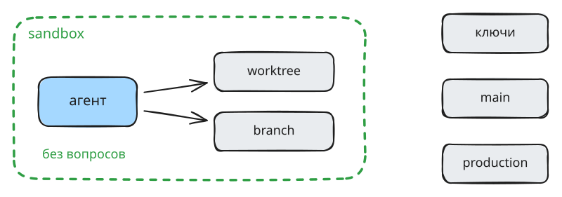

# Автономия и контроль

Агент, который спрашивает разрешение на каждую команду, работает не быстрее человека.
Агент, которому разрешено всё, однажды выполнит команду, которую нельзя отменить.
Выбирать между ними не нужно: сколько агент делает сам, задаёт цена его ошибки, а границу держит программа.

## Проблема

Посмотрите на эту картинку, она ещё понадобится.

*Схема 1: у агента два режима, и в одном он спрашивает обо всём, а в другом может всё.*

Агента запускают с подтверждением каждой команды.
Запросы идут один за другим, и скоро человек одобряет их не читая, поэтому подтверждение больше ничего не защищает.
Тогда подтверждения снимают, и агент работает без остановок.
Теперь ему доступно всё, что доступно человеку: ключи, main и production.
Одна неверная команда, и ошибку уже не вернуть.

Оба режима отвечают на вопрос, можно ли доверять агенту.
Полезнее другой вопрос: что будет, если агент ошибётся.
Ответ на него делит правую половину картинки на части.

## Принципы

### Граница

Первая часть это то, что агенту можно без вопросов.

**Автономию задаёт цена ошибки, а не доверие к агенту.**
Одна настройка доверия на все действия тормозит безопасные или пропускает опасные.
Поэтому о каждом действии задают два вопроса: можно ли его отменить и когда ошибка станет заметна.
Правку в branch можно выбросить, а необратимую операцию вернуть нельзя.

**Внутри sandbox агент не спрашивает разрешения.**
Запрос на каждую команду приучает одобрять не читая.
Поэтому границу держит sandbox: агенту видны worktree задачи и нужная ей сеть, а ключей, main и production для него нет.
Всё, что агент сделал внутри, можно выбросить вместе с branch, поэтому разрешение ему не нужно.

*Схема 2: рамка sandbox делит правую половину первой картинки, и внутри неё агент работает без запросов разрешения.*

Ту же границу можно провести иначе: отдельной учётной записью, контейнером, виртуальной машиной или отдельным компьютером.
Отдельная учётная запись закрывает агенту чужие файлы, но сеть оставляет ему открытой.
Из способов, которые закрывают агенту файлы и сеть, sandbox тратит меньше всего ресурсов.
Изоляция, которая занимает память и диск на каждого агента, ограничивает число задач, идущих одновременно.
Виртуальная машина и контейнер поднимают для агента отдельную среду, а sandbox оставляет агента обычным процессом, которому операционная система закрывает лишние файлы и сеть.
За это sandbox платит границей слабее, чем у виртуальной машины: ядро у него общее с системой.

*Схема 3: у каждого способа изоляции своя цена, а sandbox выбран, потому что закрывает файлы и сеть и оставляет агента обычным процессом.*

### Выход

Изменение не может остаться в sandbox: его нужно принять в main.
Наружу оно выходит через review gate: локальные проверки, независимое ревью и CI на открытом PR до merge.

**Чем дороже ошибка, тем ближе решение к человеку.**
Действия делятся на три группы.
То, что можно выбросить, агент делает сам, а готовность того, что можно отменить, проверяет review gate.
Merge готового изменения решает владелец проекта или правила проекта, а то, что отменить нельзя, ждёт человека.

*Схема 4: чем дороже ошибка, тем дальше решение от агента: сначала review gate, потом человек.*

### Человек

Ключи и production с первой картинки так и остались снаружи.

**Критичные и рискованные операции ждут человека.**
Ревью после необратимой операции уже ничего не предотвращает.
Пройденные проверки не дают агенту права выполнить такую операцию.
Агент готовит операцию до последнего шага и показывает, что изменится, а человек решает до неё, а не по логу после.

**Что считать критичным, решает список в коде, а не модель.**
Модель, которая сама отличает рутинный вопрос от критичного, однажды ответит на критичный.
Поэтому программа сверяет каждый вопрос со списком критичных и рискованных операций, и вопрос из списка идёт сразу к человеку.
Decider, малая модель для рутинных вопросов, на такой вопрос не отвечает ни по какому правилу, а вопрос без ответа ждёт, потому что молчание не считается согласием.

*Схема 5: рутинный вопрос закрывает decider, а критичную операцию и вопрос без правила получает человек.*

**Повторный сбой останавливает агента.**
Агент, у которого команда падает раз за разом, повторяет её и тратит лимит.
Причина часто не в команде, а в задаче: не хватает данных, или критерий готовности проверяет не тот результат.
Поэтому после нескольких одинаковых сбоев программа ставит работу на паузу и задаёт вопрос человеку.

Сравните это с первой картинкой.
Там был один переключатель: спрашивать обо всём или разрешить всё.
Здесь агент работает внутри sandbox без запросов разрешения, а review gate проверяет, готово ли изменение.
Merge решает владелец проекта или правила проекта, а то, что нельзя отменить, всегда решает человек.

## Как это устроено в Orc

Orc это мой оркестратор с открытым кодом, и эти границы в нём держит код.
Схема ниже собирает все картинки статьи в одну.
Вопросы на ней попадают в attention queue, общую очередь вопросов к decider и к человеку.

*Схема 6: агент свободен внутри sandbox, а наружу ведут два пути, review gate и attention queue.*

## Ресурсы

- [Где Orc останавливает агента](https://avi2d.github.io/agent-practice/blog/autonomy-orc.html): интерактивная версия схемы 6
- [Orc](https://github.com/avi2d/orc): исходный код оркестратора
- [Документация Orc](https://avi2d.github.io/orc/): устройство run, проверок, attention queue и merge
