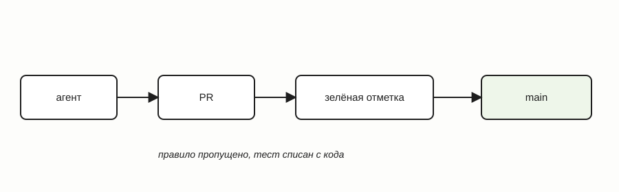
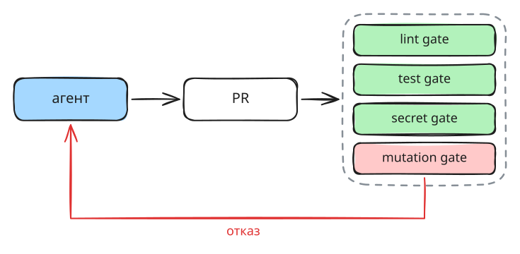
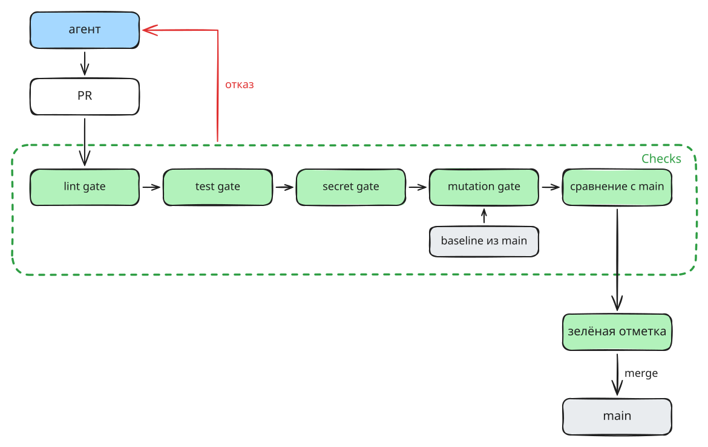

# Checks: gate, которые ловят то, что агент пропускает

Агент сдаёт PR с зелёной отметкой.
Отметка говорит только о том, что проверки прошли, но не о том, что они что-то проверили.
Ревьюер видит одно слово passed и не знает, какое правило проверено и на каких строках.

## Проблема

Одна зелёная отметка на весь PR выглядит так.

*Схема 1: одна зелёная отметка не называет, какое правило проверено и на каких строках.*

Агент получает задачу и сдаёт PR с одной отметкой passed.
Правило из инструкции он пропустил, а тест написал по собственному коду, и тест прошёл.
Отметка не говорит, какое правило прошло и на каких строках, поэтому ревьюер видит только слово passed.
Ошибка уходит в main с зелёной отметкой.

Дальше одна отметка распадается на gate, которые идут по порядку, и у каждого своё правило.

## Принципы

Принципы разбирают, какой должна быть отметка, что получает агент при отказе и как устроен каждый gate.

### Отметки

Проверка, которая отказывает изменению, если записанное правило нарушено, называется gate.
Первой меняется сама отметка.

**Каждый gate ставит свою отметку.**
Одна общая отметка не называет правило, и агент не знает, что именно нарушил.
Каждый gate держит одно записанное правило и ставит на PR отметку со своим именем.
Отметка PR становится зелёной, только когда зелёные отметки всех gate.

### Отказ

Отметка называет gate, и следующий вопрос в том, что агент получает при отказе.

**Отказ называет файл, строку и причину, а исправляет агент.**

**Обход gate тоже получает отказ.**
Правило нельзя отключить комментарием, а число старых исключений может только уменьшаться.
Пропуск теста требует причину, иначе gate пропуска теста отказывает.

*Схема 2: у checks-lint, checks-test, secret gate и checks-mutation своя отметка, а отказ одного из них возвращает изменение агенту.*

### Правила

Агент знает, какой gate отказал, и дальше вопрос в том, откуда берутся сами правила.

**Каждое правило, которое агент может пропустить в инструкции, становится отдельным gate.**
Правила кода, архитектуры, коммитов и документации проверяются на каждом PR.
Новое правило судит только строки, которых коснулось изменение.

### Тест

Правила проверяют код, а следующий gate проверяет тест, который агент написал к нему.

**Новый тест сначала падает, а ожидаемое значение приходит не из проверяемого кода.**
Тест, который не упал до исправления, не доказывает исправление.

### Секрет

Тест проверяет поведение кода, а следующий gate смотрит, что ещё попало в diff.

**Секрет не попадает в diff.**
Пароль или токен, попавший в branch, считается раскрытым, даже если следующий коммит его удалил.
Поэтому secret gate ищет секреты в добавленных строках, отказывает и требует отозвать найденный секрет, а не только удалить его из файла.
Сам secret gate работает под узким отзываемым доступом: он читает diff и пишет статус, но не делает merge.

### Мутации

Новый тест падает до исправления, а дальше проверку получают все тесты сразу.

**Тесты проверяет мутация, а не покрытие.**
Gate сравнения с main отказывает изменению, в котором выжил мутант, убитый в main.

### Main

Все gate стоят на пути в main, и дальше меняется то, как изменение туда попадает.

**Main принимает только то, что прошло все gate.**
Прямая запись в main обходит все gate, поэтому её закрывают правилами защиты main.
Решение о merge принимает правило проекта, а не агент.
Все gate запускаются в одной изолированной среде вокруг всей системы агентов, а не в отдельной sandbox на каждого агента.

### Ревью

Последний вопрос в том, откуда приходят новые gate.

**Повторное замечание ревью становится новым gate.**

Сравните с первой картинкой.
Там одна зелёная отметка не называла проверку, и ошибка уходила в main.
Здесь у checks-lint, checks-test, secret gate и checks-mutation своя отметка, а отказ возвращает изменение агенту до merge.

## Как это устроено в Checks

Checks запускает на каждом PR три команды и отдельный secret gate.

- `checks-lint` запускает gate для каждого правила из инструкции.
- `checks-test` запускает gate нового теста и gate пропуска теста.
- `checks-mutation` запускает gate мутаций и gate сравнения с main.

Orc отдаёт агенту отказ с файлом и строкой, а агент присылает исправление, которое снова проходит все gate.
Новое правило приходит в каждый репозиторий обновлением общей зависимости, а не копированием настроек.

*Схема 3: изменение проходит все gate по порядку, а отказ возвращается агенту с файлом и строкой.*

## Ресурсы

- [Путь PR через Checks](https://avi2d.github.io/agent-practice/blog/checks.html): интерактивная версия схемы 3
- [Checks](https://github.com/avi2d/checks): исходный код набора проверок
- [Документация Checks](https://github.com/avi2d/checks/tree/main/docs): описание каждого gate и общих настроек
- [Orc](https://github.com/avi2d/orc): запускает агентов и передаёт им отказы Checks
