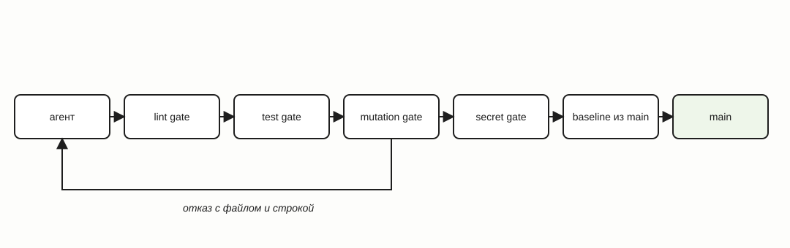

# Checks: gate, которые ловят то, что агент пропускает

Агент сдаёт PR с зелёной отметкой, а отметка говорит только о том, что проверки прошли, но не о том, что они что-то проверили.
Мой ответ: Checks, набор gate, то есть проверок, которые отказывают изменению, если записанное правило нарушено, и называют место отказа.
Агент читает отказ, исправляет его, и отметка становится зелёной, только когда каждый gate прошёл.

## Проблема

Посмотрите на эту картинку, она ещё понадобится.

*Схема 1: одна зелёная отметка не называет, какое правило проверено и на каких строках.*

Агент получает задачу и сдаёт PR с одной отметкой passed.
Правило из инструкции он пропустил, а тест написал по собственному коду, и тест прошёл.
Отметка не говорит, какое правило прошло и на каких строках, поэтому ревьюер видит только слово passed.
Ошибка уходит в main с зелёной отметкой.

Дальше каждая проверка называется, держит своё правило и показывает место отказа.

## Принципы

Принципы, у которых не названо исследование, это моя позиция.

### Правила

**Каждый gate держит одно записанное правило.**
Общая отметка не называет правило, и агент не знает, что именно нарушил.
Поэтому у каждого gate своё имя, и отметка показывает, какой gate прошёл, а какой отказал.
Gate держит только записанное: правило о запрете циклов в зависимостях не говорит, хорошо ли устроен модуль.

**Gate отказывает и называет файл, строку и причину.**
Отказ «ошибка» без места тратит время агента на поиск, а не на исправление.
Поэтому отказ содержит файл, строку, правило и то, что нужно исправить, а gate ничего не правит сам.
Исправляет агент, и его исправление снова проходит все gate.

**Обход gate считается нарушением.**
Агент, которому gate мешает, идёт к зелёной отметке кратчайшим путём: отключает правило комментарием, пропускает тест или ослабляет ожидание.
Поэтому Checks отказывает в комментарии, который отключает проверку, а число старых исключений может только уменьшаться.
Пропущенный тест называет причину и возвращается в общий прогон к назначенному сроку.

**Новое правило судит только изменённые строки.**
Правило, которое в первый день отказывает всему репозиторию, блокирует чужую работу, и его отключают.
Поэтому gate проверяет строки, которых коснулось изменение, а нетронутый код проходит.
Цена этого решения: старое нарушение живёт до первой правки в его строке.

### Тесты

**Тест сначала падает.**
Тест, который ни разу не падал, не показал, что умеет падать.
Поэтому Checks запускает новый тест до исправления и требует отказ по нужной причине, а после исправления требует прохождения.
Отказ из-за ошибки в запуске самого теста не считается.

**Ожидаемое значение приходит извне.**
Тест, списанный с реализации, закрепляет её ошибку: код и тест согласны, и оба неверны.
Поэтому ожидаемое значение берут из критерия приёмки, записанного в задаче до работы, или из внешнего контракта.
Исследование EvalPlus показало, что исходные тесты к задачам на генерацию кода пропускали неверный код, который отвергали более строгие тесты.
Это задачи на отдельные функции, а не работа агента в репозитории, но механизм тот же: слабый тест принимает неверный код.

**Тесты проверяет мутация, а не покрытие.**
Покрытие говорит, что строка выполнилась, а не что тест заметит её поломку.
Поэтому mutation gate вносит в код намеренную ошибку, например меняет `>` на `>=`, и запускает тесты на изменённой копии.
Мутант, с которым тесты прошли, выжил и показал пробел в тестах, и агент закрывает его тестом на этот случай.
Исследование Google 2021 года по мутационному тестированию в промышленном коде нашло, что для большинства разобранных исправленных ошибок существовал мутант, который тесты пропускали до исправления.
Это разбор уже исправленных ошибок, а не подсчёт ошибок, которые мутация предотвратила.

### Сравнение с main

**Gate сравнивает PR с main по каждому мутанту.**
Порог по общему проценту выполняют тестами на простой код, а потерянная проверка прячется за новыми мутантами.
Поэтому мутант, убитый в main и выживший в PR, это потерянная проверка, и она останавливает изменение.

### Секреты

**Секрет не попадает в diff.**
Пароль или токен, попавший в branch, считается раскрытым, даже если следующий коммит его удалил.
Поэтому secret gate ищет секреты в добавленных строках, отказывает и требует отозвать найденный секрет, а не только удалить его из файла.
Сам secret gate работает под узким отзываемым доступом: он читает diff и пишет статус, но не делает merge.

**Main защищён, и в него попадает только то, что прошло gate.**
Прямая запись в main обходит все gate, поэтому её закрывают правилами защиты main.
Решение о merge принимает правило проекта, а не агент.
Все gate запускаются в одной изолированной среде вокруг всей системы агентов, а не в отдельной sandbox на каждого агента.

### Скорость

**Gate смотрит только на то, чего коснулось изменение.**
Медленная проверка задерживает каждого агента, и её начинают пропускать.
Поэтому на PR идут только gate, до которых дотягивается diff, а полный прогон идёт по расписанию.

### Ревью

**Повторное замечание становится gate.**
Замечание ревью, которое приходит второй раз, показывает правило, живущее только в памяти.
Поэтому такое правило переносят в Checks новым gate, и следующее изменение получает отказ, а не замечание.
Ревью остаётся за тем, что программа не выразит: соблюдён ли контракт за границей изменённого файла.

Сравните с первой картинкой.
Там одна зелёная отметка не называла проверку.
Здесь каждая отметка называет gate, строку и правило, которое он держит.

## Как это устроено в Checks

Checks запускает gate в одном порядке: lint, тесты, которые падают до исправления, мутанты, secret gate и сравнение с main.
Orc отдаёт агенту отказ с файлом и строкой, а агент присылает исправление, которое снова проходит все gate.
Новое правило приходит в каждый репозиторий обновлением общей зависимости, а не копированием настроек.
Main защищён, поэтому merge возможен только для изменения, которое прошло все gate.

*Схема 2: изменение проходит все gate по порядку, а отказ возвращается агенту с файлом и строкой.*

## Ресурсы

- [Checks](https://github.com/avi2d/checks): исходный код набора проверок
- [Документация Checks](https://github.com/avi2d/checks/tree/main/docs): описание каждого gate и общих настроек
- [Orc](https://github.com/avi2d/orc): запускает агентов и передаёт их изменения в Checks
- [Is Your Code Generated by ChatGPT Really Correct?](https://arxiv.org/abs/2305.01210v3): исследование EvalPlus о тестах, которые принимают неверный код
- [Does mutation testing improve testing practices?](https://arxiv.org/abs/2103.07189v1): исследование мутационного тестирования в промышленном коде
