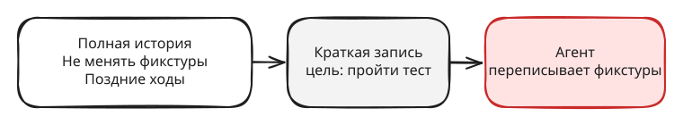
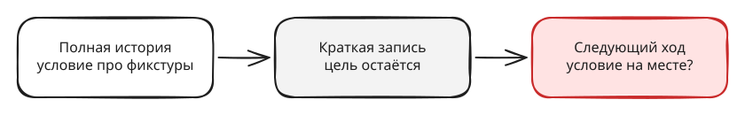
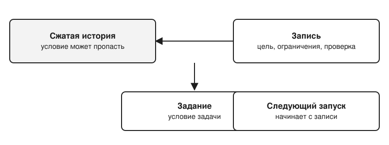
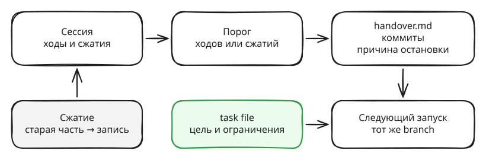

# Контекст и сжатие

Кодовый агент получает на каждом ходе весь текст, который модель видит: задачу, прочитанные файлы и историю сессии.
Когда сессия длится дольше, этот текст перестаёт помещаться в окно модели, и старую историю приходится сжимать.
Сжатие освобождает место, но может стереть условие, от которого зависит результат.

## Проблема

Агента просят сделать так, чтобы тест проходил, и ставят условие: файлы фикстур не менять.
Сессия доходит до порога, и агентная программа заменяет старую часть истории краткой записью.
В записи осталась цель, а условие про фикстуры пропало.
Агент решает, что проще переписать фикстуры, и переписывает их.
Пример условный, но такой сбой возможен, когда условие написано только в начале истории.

*Схема 1: условие про фикстуры было в старой части истории, которую заменила краткая запись, и агент его уже не видит.*

Помните агента, который переписал фикстуры?
Чтобы сжатие не теряло условия, сначала нужно понять, что модель видит и как устроено сжатие.

## Принципы

Сжатие сохраняет то, что нужно следующему ходу, и проверяется по нему, а не по длине записи.
Принципы идут от того, что модель видит, к сжатию и к записи, с которой начинается следующий запуск.

### Что модель видит

**Длинный контекст ухудшает ответ, даже когда он помещается в окно.**
В исследовании Lost in the Middle, опубликованном в 2023 году, модели на задачах поиска сведений во входе чаще использовали начало и конец входа, чем середину.
Качество заметно падало, когда нужные сведения стояли в середине длинного входа.
Исследование проверяло модели 2023 года, поэтому из него не следует, сохраняется ли этот эффект у моделей 2026 года.

### Сжатие

Теперь вернёмся к записи, из которой пропало условие про фикстуры.

**Сжатие проверяют по следующему ходу агента, а не по тому, как выглядит запись.**
В работе ACON, опубликованной в 2025 году, правила сжатия уточняли по разбору сбоев агента.
По аннотации на 27 ноября 2026 года её метод снизил пиковое число токенов от 26 до 54% на наборах AppWorld, OfficeBench и задач с несколькими вопросами и повысил долю успешных задач относительно прежних методов сжатия.
Источник не измеряет кодовых агентов и не проверяет, сохраняются ли в записи ограничения задачи, поэтому такую проверку нужно делать отдельно.

**Сжатие сравнивают с полной историей на одинаковых сессиях.**
Без такого сравнения дешёвое сжатие, которое теряет условие, проходит незамеченным.
Сравнение показывает стоимость и исход каждой версии и отдельно проверяет, остались ли в записи цель, ограничения и последняя проверка.
Один случай такого сравнения не даёт: нужны сессии, список фактов до и после сжатия и правило, по которому потеря факта меняет исход задачи.

*Схема 2: сжатие проверяют по следующему ходу агента: пропавшее условие видно в самом ходе, а длина записи этого не показывает.*

### Контрольная точка

Если задача продолжается в другом запуске, ему тоже нужна запись с условиями.

**Длинную задачу передают через записанную точку, а не через сжатую историю.**
Следующий запуск, который продолжает сжатую историю, не видит условия, если оно из неё пропало.
Поэтому цель, ограничения и ближайшую проверку записывают в task file, то есть в файл задачи, из которого каждый запуск берёт задание.

*Схема 3: условие задачи приходит в следующий запуск из task file, а handover.md несёт только коммиты и причину остановки.*

Схема 1 показывает, что бывает, когда условие пропало из записи: агент переписал фикстуры.
Схема 2 проверяет то же место на следующем ходу, а схема 3 передаёт условие следующему запуску через task file.

## Как это устроено в Orc

Orc запускает агентную программу, и она сжимает историю сама, когда свободного места остаётся мало.
Сжатие заменяет старую часть истории краткой записью, а последние ходы остаются без изменений.
Orc считает ходы, то есть ответы модели вместе с её действиями, и сжатия в каждой сессии.
Когда их число доходит до порога, он записывает `handover.md` со сделанными коммитами и причиной остановки.
Следующий запуск на том же branch продолжает с handover.md.
Условие задачи он получает из task file, а не из сжатой истории.

*Схема 4: на пороге по числу ходов или сжатий Orc записывает handover.md, а следующий запуск начинает с этой записи и получает условие задачи из task file.*

## Ресурсы

Здесь собраны все ссылки статьи: исследования, документация и исходный код Orc.

- [Сжатие и передача в Orc](context-orc.html): интерактивная схема с пояснением каждого шага
- [Lost in the Middle](https://arxiv.org/abs/2307.03172): исследование, в котором модели хуже использовали сведения из середины входа
- [ACON](https://arxiv.org/abs/2510.00615): работа о сжатии контекста агентов с числами на трёх наборах задач
- [Orc: сессия и handover](https://github.com/avi2d/orc/blob/6b8142d4288f592f0615a14ae286967f12357751/docs/concepts/run.md): task file запуска и правило передачи по числу ходов или сжатий
- [Orc: запуски и handover.md](https://github.com/avi2d/orc/blob/main/docs/run/running-a-task.md): что записано в handover.md
- [Orc](https://github.com/avi2d/orc): исходный код оркестратора
