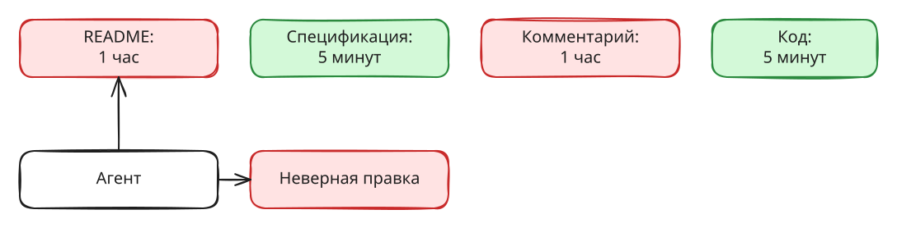

# Документация, спецификации и комментарии

Одно правило обычно записано сразу в нескольких местах: в README, в спецификации и в комментарии над кодом.
Через несколько правок записи расходятся, а читатель берёт ту, что попалась первой.

## Проблема

Пример вымышленный.
Срок хранения ответа в кэше записан в README, в спецификации и в комментарии над функцией кэша, и везде стоит один час.

*Схема 1: одно правило записано в трёх местах, и обновился только код.*

Через полгода срок сократили до пяти минут и поменяли только код.
Агент, которому дали задачу по README, написал кэш с часовым сроком, и ни одна проверка этого не заметила, потому что ни одна не сравнивает README с кодом.
Читатель, открыв любую из трёх записей, видит уверенный текст и не может понять, какая из них верна.
Дальше разобрано, какие сведения где держать, чтобы у каждого факта оставалась одна запись.

## Принципы

Принципы разбирают, где записывать каждый факт, как писать инструкции для агента и спецификацию и какие комментарии оставлять в коде.

### Назначение и первые шаги

**README отвечает незнакомому человеку на три вопроса: зачем проект, что с ним можно делать и как начать.**
Без этих ответов новый читатель тратит время на догадки, прежде чем поймёт, нужен ли ему проект.
Руководство GitHub описывает README так же: текст о пользе проекта, о том, что с ним можно делать, и о том, как им пользоваться.

**README отсылает к подробностям и не копирует их.**
Копия правила в README стареет раньше кода, и читатель получает старый текст без предупреждения.
Поэтому README называет место, где лежит полный текст.

### Инструкции для агента

**Файл инструкций задаёт границы работы и называет, где искать подробности.**
Агент без границ угадывает, какие части проекта можно трогать, и каждая догадка требует проверки.
Исследование Gloaguen и соавторов, препринт arXiv за февраль 2026 года, проверило файлы инструкций на 300 задачах SWE-bench Lite и 138 задачах из 12 репозиториев с файлами разработчиков.
В целом файлы не повысили долю решённых задач, а стоимость вызова выросла больше чем на 20%, хотя авторы считают их полезными для нестандартных практик.

**Правило, которое может проверить программа, записывает программа, а текст инструкции называет причину.**
Текст агент может прочесть и не выполнить, а отказ проверки пропустить нельзя.
Руководство ArchUnit описывает проверку циклов, которая отвергает изменение, создавшее цикл между заданными группами кода.
Проверка видит только связи, которые умеет считать, поэтому правило о понятности кода ею не заменить.

### Один источник для каждого факта

**Каждый факт записан в одном месте, а остальные документы на него ссылаются.**
Две записи одного факта расходятся при первой правке, и никто не видит, какая из них верна.
Поэтому README, инструкции и спецификация указывают на место, где факт записан, и не переписывают его.

**Документация описывает устройство сейчас, а запись решения объясняет, почему оно такое.**
Если смешать текущее устройство и причины выбора, читатель не отличит действующее от прежнего.
Формат записи архитектурного решения, описанный Nygard, оставляет контекст, решение, статус и последствия, а рассмотренные варианты стоит записать в контексте.
Например, описание run в Orc называет условия, при которых запуск записывается как успешный.

### Спецификация

**Спецификация задаёт наблюдаемое поведение до реализации, чтобы результат можно было сравнить с ней.**
Без неё ожидаемый результат выводят из уже написанного кода, и ошибку в коде трудно заметить.
Руководство NASA по требованиям предлагает проверять требование проверкой, анализом, демонстрацией или испытанием.
Например, для отмены правки можно заранее записать, что должно остаться доступно после неё.

**Спецификация API описывает контракт, а не обработчик.**
Спецификация OpenAPI 3.1.1 формально описывает поверхность API и её семантику, и по ней можно сверить ответ, не читая код.
Не каждому проекту нужна спецификация на всю систему, а такой текст сам не синхронизируется с кодом.

**Устаревшая спецификация может направить агента к неверному изменению, и это гипотеза.**
Если спецификация обещает один ответ, а контракт уже требует другой, агент следует старому тексту.
Исследование Gloaguen и соавторов показало, что агенты хорошо следуют инструкциям, но не проверяло устаревшие файлы, поэтому частоту такой ошибки из него не вывести.
Практическая проверка при смене контракта: прогнать один и тот же пример требования и реализации.

### Код и комментарии

**Смысл выражают имя, тип и структура раньше, чем комментарий.**
Комментарий устаревает при правке кода, а тип компилятор проверяет при каждой сборке.
Тип с различимыми вариантами в TypeScript позволяет записать, какие данные есть в каждом состоянии, и компилятор проверяет их использование.

*Схема 2: факт записан в коде, а README только ссылается на него.*

**В коде остаются только комментарии двух видов.**
Первый называет ограничение, которое исключает очевидный подход, а второй называет инвариант, который система типов не может выразить.
Лицензионный заголовок остаётся, потому что это условие лицензии.
Обоснование, которому нужен абзац, хранится в записи решения, а история изменений в сообщении коммита.

Сравните с первой картинкой: там одно правило было записано в трёх местах.
Здесь у каждого факта одна запись, спецификация держит поведение, а запись решения держит причину.

## Ресурсы

- [Руководство GitHub по README](https://docs.github.com/en/repositories/managing-your-repositorys-settings-and-features/customizing-your-repository/about-readmes): назначение README и вопросы, на которые он отвечает
- [ArchUnit, Cycle Checks](https://www.archunit.org/userguide/html/000_Index.html#_cycle_checks): проверка циклов между группами кода
- [Documenting Architecture Decisions, Nygard](https://cognitect.com/blog/2011/11/15/documenting-architecture-decisions): формат записи архитектурного решения
- [NASA, Appendix C: How to Write a Good Requirement](https://www.nasa.gov/reference/appendix-c-how-to-write-a-good-requirement/): требование, которое можно проверить
- [OpenAPI Specification 3.1.1](https://spec.openapis.org/oas/v3.1.1.html): описание API и его семантики
- [TypeScript Handbook, Narrowing: Discriminated unions](https://www.typescriptlang.org/docs/handbook/2/narrowing.html#discriminated-unions): тип с различимыми вариантами
- [Gloaguen и соавторы, Evaluating AGENTS.md](https://arxiv.org/abs/2602.11988v3): файлы инструкций для агентов на SWE-bench Lite и на задачах из репозиториев разработчиков
- [Описание run в Orc](https://github.com/avi2d/orc/blob/6b8142d4288f592f0615a14ae286967f12357751/docs/concepts/run.md#L33-L43): условия, при которых запуск записывается как успешный
