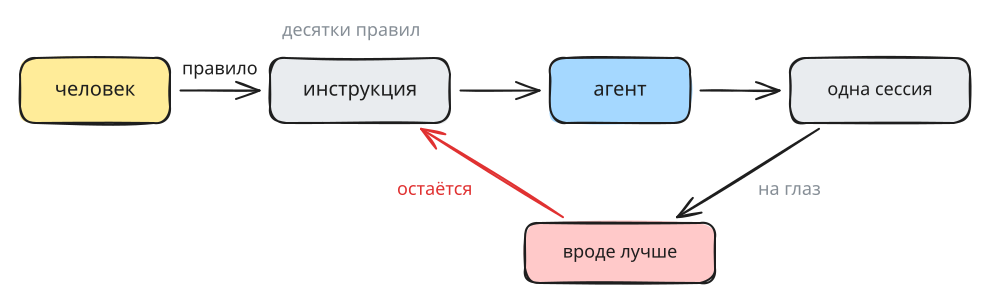
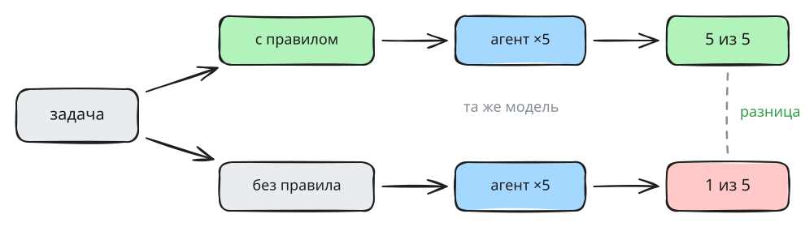
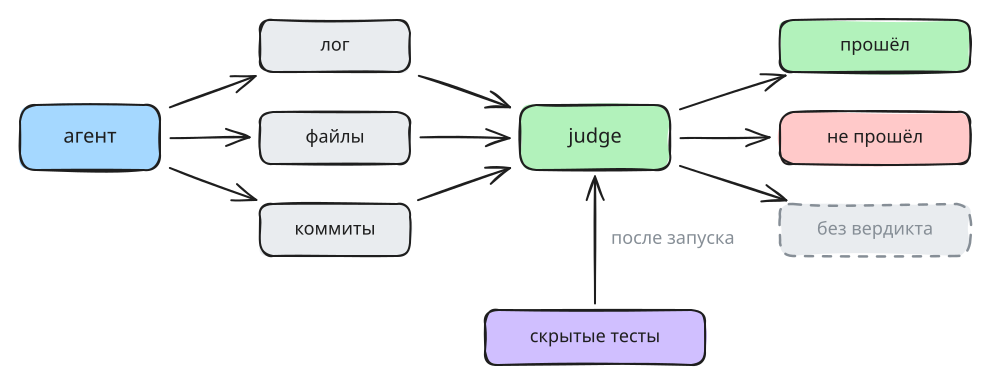
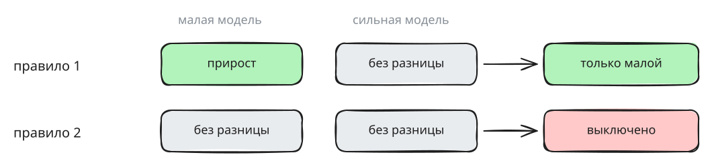
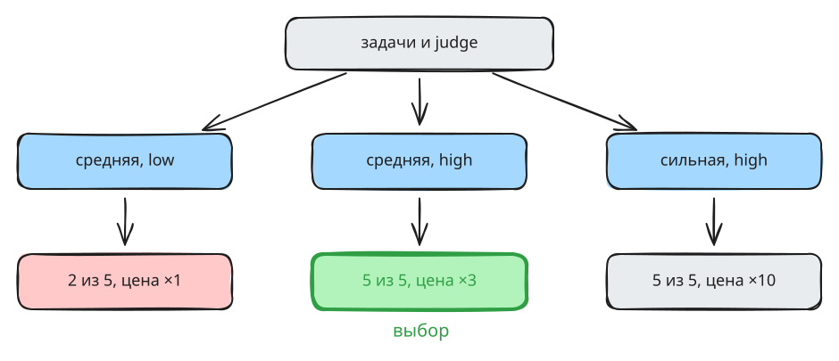
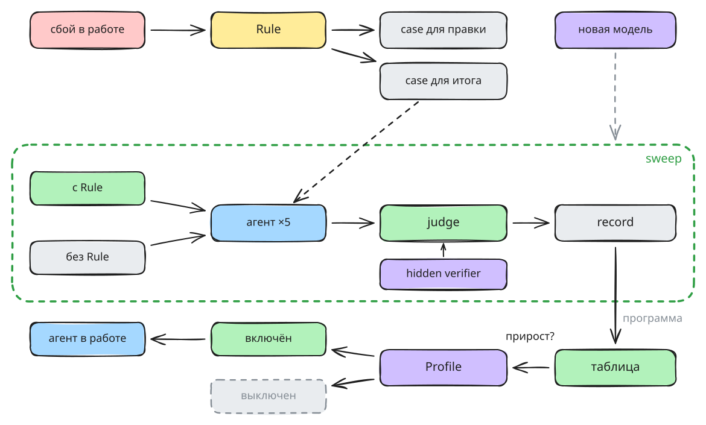

# Оценка агентов и навыков

Правило в инструкции агента, навык и модель обычно выбирают по одной удачной сессии.
Основание для выбора даёт сравнение, в котором одна задача несколько раз идёт с изменением и без него, а вердикт выносит программа.
Правило, которое не дало прироста, выключается.

## Проблема

Посмотрите на эту картинку, она ещё понадобится.

*Схема 1: правило попадает в инструкцию по одной сессии и оценке на глаз, и после этого его никто не проверяет.*

Агент прочитал в контекст лог целиком, и в инструкцию добавили правило о работе с логами.
В следующей сессии агент отфильтровал лог, и правило осталось.
Задача в этой сессии была другой, запуск был один, а результат оценил на глаз тот, кто написал правило.
Так в инструкцию попали десятки правил, и каждое занимает контекст в каждой сессии.
Модель с тех пор сменилась, и никто не знает, какие из правил ещё что-то меняют.

На картинке три слабых места: одна случайная сессия, оценка на глаз и правило, которое остаётся навсегда.
Дальше каждое из них получает замену.

## Принципы

Принципы, у которых не названо исследование, это моя позиция.

### Задачи

Первой с картинки уходит случайная сессия.

**Оценка измеряет систему на задачах, а не модель.**
Модель выбирают по числу из чужой таблицы, хотя это число получила другая система на других задачах.
В SWE-agent 2024 года на одной модели и 300 задачах SWE-bench Lite интерфейс, спроектированный для модели, дал 18,0% решённых задач против 11,0% у shell.
Поэтому оценивают то сочетание модели, инструментов и инструкций, которое получает работу.

**Задачи берут из собственной работы.**
Публичный набор показывает работу агента в чужих репозиториях и ничего не говорит о правиле, написанном после сбоя в своём.
Поэтому каждое правило получает задачи, которые воспроизводят его сбой: небольшой репозиторий и поручение, в котором агент без правила ошибается.
Задача для правила о логах содержит длинный лог и вопрос, ответ на который лежит в нескольких строках.

**Задачи итоговой оценки не используют при настройке.**
Правило, которое правят, пока оно не пройдёт свои задачи, подогнано под них, и его результат ничего не говорит о новой работе.
Поэтому текст правила правят на одних задачах, а итог считают на других.
Обзор «AI Agents That Matter» 2024 года показал, что у 7 из 17 наборов задач отложенный набор не запланирован, но падение результата не измерял.

### Сравнение

Задачи есть, и теперь нужно узнать, меняет ли правило работу агента.

**Меняют одно, а остальное держат.**
Когда между двумя сессиями сменились задача, модель и правило, разницу нельзя приписать правилу.
Поэтому агент выполняет одну задачу с правилом и без него на той же модели в среде, собранной с нуля, без других правил и настроек.
В SkillsBench 2026 года навыки подняли среднюю долю решённых задач с 33,9% до 50,5% на 87 задачах и 18 сочетаниях модели и среды запуска.

*Схема 2: одна задача идёт с правилом и без него, и между вариантами отличается только правило.*

**Один запуск не даёт ответа.**
Агент решает одну задачу по-разному от запуска к запуску, и одна удача или один сбой ничего не значат.
Поэтому каждая задача идёт несколько раз в каждом варианте, а итог это две доли успеха и статистическая значимость разницы между ними.
Запуск, который оборвался или не дошёл до задачи, остаётся без вердикта и в долю успеха не входит.

### Вердикт

На первой картинке результат оценивал на глаз тот, кто написал правило.

**Вердикт выносит программа.**
Человек ждёт пользы от своего правила, а модель в роли судьи может дать разный вердикт одному и тому же результату.
Поэтому, как и в SkillsBench, вердикт выносит детерминированная программа judge, которая читает лог запуска, изменённые файлы и коммиты.
Сам judge проверен тестом, в котором он отказывает заведомо плохому результату и пропускает заведомо хороший.

**Следование правилу и результат работы измеряют отдельно.**
Judge, который читает ход работы, показывает, что агент выполнил правило, но не показывает, что задача решена верно.
Поэтому у задачи на результат есть скрытые тесты по её условию, которые попадают в среду только после того, как агент закончил.
До первого прогона тест подтверждает, что скрытые тесты падают на неисправленном коде и на правдоподобном неверном исправлении.

*Схема 3: вердикт выносит программа по логу, файлам и коммитам запуска, а скрытые тесты приходят после того, как агент закончил.*

**Запись оценки не правят.**
Число без условий нельзя ни проверить, ни сравнить с новым.
Поэтому каждый прогон оставляет запись: модель, reasoning effort, число повторов, коммит, хеш текста правила и вердикт каждого запуска с основанием.
Запись попадает в репозиторий и больше не меняется, новое измерение даёт новую запись, а сводную таблицу из записей собирает программа.

### Решение

Осталось правило, которое на первой картинке попало в инструкцию навсегда.

**Правило без прироста выключают.**
Правило занимает контекст в каждой сессии, куда попадает, и правило, которое ничего не меняет, тратит его впустую.
Поэтому правило, у которого доли успеха в двух вариантах не различаются, выключается.
В SkillsBench компактные навыки дали прирост 19,0 процентного пункта, а исчерпывающие 0,7, но на разных группах задач, так что причина не доказана.

**Правило включают для той модели, которой оно помогает.**
Правило, которое исправляет слабую модель, сильной может ничего не дать, а включённое для всех занимает контекст у каждой.
В SkillsBench прирост от навыков менялся от 4,1 до 25,7 процентного пункта между сочетаниями модели и среды запуска.
Поэтому сравнение идёт на каждой модели отдельно, и правило получает только та модель, на которой оно дало прирост.

*Схема 4: правило остаётся только у той модели, на которой оно дало прирост.*

**После смены модели оценку повторяют.**
Вердикт получен на одной версии модели и на новую не переносится.
Поэтому новая модель проходит те же задачи с каждым правилом и без него.

### Модель и reasoning effort

Тем же способом выбирают и то, на чём агент работает.

**Модель и reasoning effort выбирают тем же сравнением.**
Модель, выбранная по общему рейтингу, получает работу, с которой справляется и дешёвая.
Поэтому задачи и judge остаются теми же, а между запусками меняется только модель или reasoning effort.
В SkillsBench меньшие модели с навыками сравнялись с более крупными моделями без навыков.

**Долю успеха читают вместе с ценой.**
Обзор «AI Agents That Matter» связывает сравнение по одной точности с агентами, которые сложнее и дороже, чем нужно.
Поэтому запись хранит расход токенов, цену и число шагов каждого запуска.
Из вариантов, у которых доли успеха не различаются, работу получает самый дешёвый.

*Схема 5: из вариантов с одинаковой долей успеха работу получает самый дешёвый.*

Сравните это с первой картинкой.
Там правило попадало в инструкцию по одной сессии и оставалось навсегда.
Здесь у правила есть свои задачи, запуски идут парами и с повторами, вердикт выносит программа, а запись хранит условия.
Правило работает, пока сравнение показывает прирост.

## Как это устроено в skills

Библиотека skills с открытым кодом хранит мои инструкции для агентов, и каждая из них проходит оценку по этим принципам.
Rule это инструкция, которую программа доставляет агенту по триггеру, case это задача оценки, а sweep это один прогон.
Запись sweep называется record, скрытые тесты case называются hidden verifier, а Profile называет Rule, которые получает модель.
Схема ниже собирает все картинки статьи в одну.

*Схема 6: Rule проходит sweep на каждой модели, и Profile включает его только там, где есть прирост.*

## Ресурсы

- [Как skills оценивает Rule](https://avi2d.github.io/agent-practice/blog/evaluation-skills.html): интерактивная версия схемы 6
- [skills](https://github.com/avi2d/skills): исходный код библиотеки инструкций
- [Measure a Rule](https://github.com/avi2d/skills/blob/main/docs/measure-a-rule.md): как запустить sweep и прочитать его запись
- [Eval sweeps](https://github.com/avi2d/skills/blob/main/evals/sweeps/README.md): таблица результатов по каждому Rule и case
- [SWE-agent: Agent-Computer Interfaces Enable Automated Software Engineering](https://arxiv.org/abs/2405.15793v3): исследование о том, как интерфейс агента меняет результат на одной модели
- [AI Agents That Matter](https://arxiv.org/abs/2407.01502v1): обзор наборов задач для агентов, их отложенных частей и учёта цены
- [SkillsBench: Benchmarking How Well Agent Skills Work Across Diverse Tasks](https://arxiv.org/abs/2602.12670v4): парное сравнение работы агентов с навыками и без них
