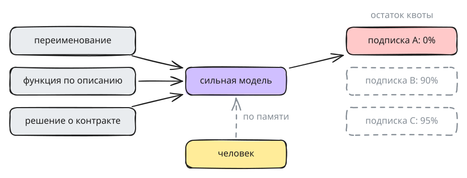
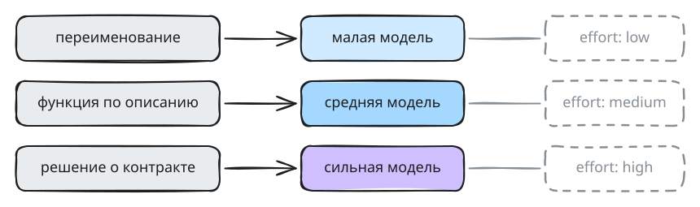
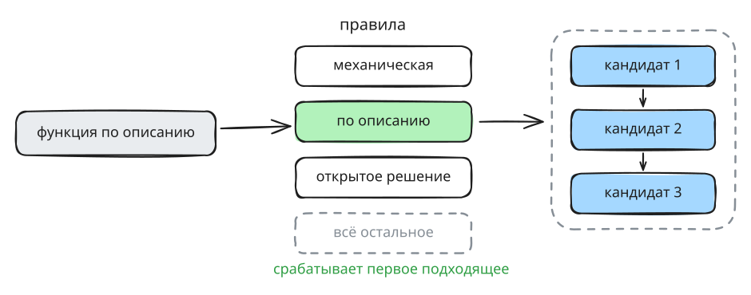
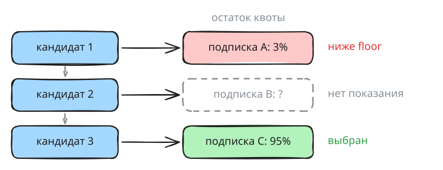
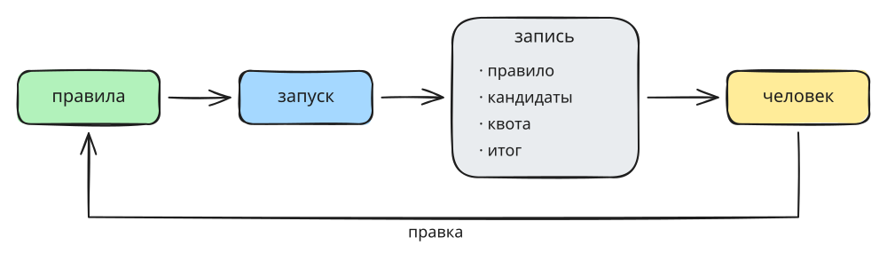
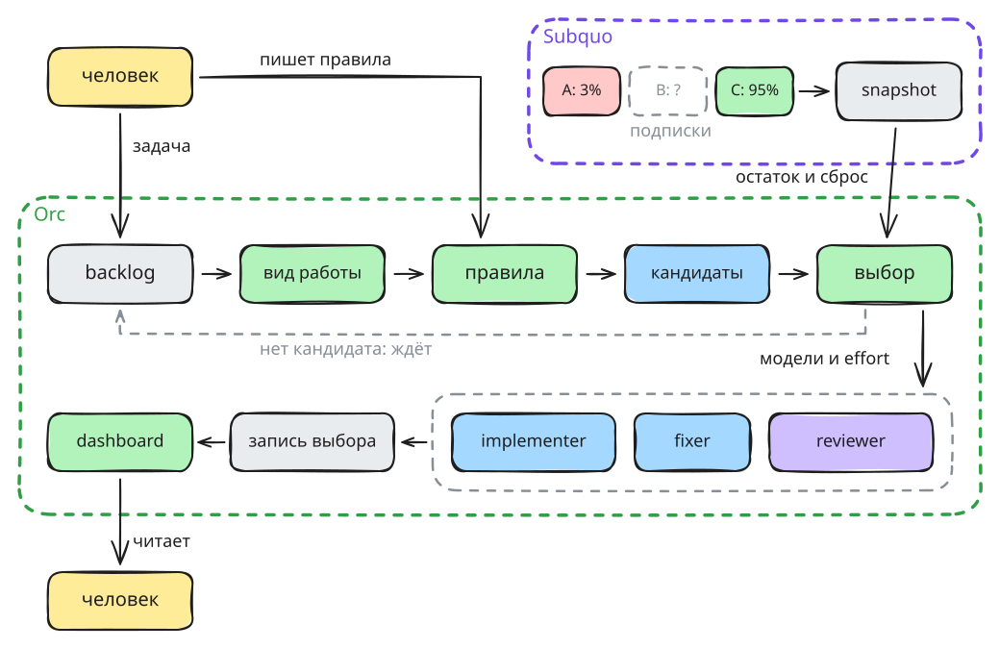

# Выбор модели и reasoning effort

Одна модель на все задачи ошибается в обе стороны.
Сильная тратит квоту на переименования, а малая получает изменение, которое ей не по силам.
Поэтому модель и reasoning effort выбирают правила: по виду работы, по цене ошибки и по остатку квоты на каждой подписке.

## Проблема

Посмотрите на эту картинку, она ещё понадобится.

*Схема 1: все задачи идут на одну модель, и её подписка пуста, пока две другие простаивают.*

Каждая задача идёт на самую сильную модель с высоким reasoning effort, потому что так кажется надёжнее.
Переименование и функция с открытым проектным решением получают одну и ту же модель.
К середине недели квота этой подписки кончается, и очередь стоит, хотя две другие подписки почти не тронуты.
Тогда задачи вручную переводят на другую модель и выбирают её по памяти о прошлых запусках.
Сложное изменение попадает на малую модель, и его исправление стоит дороже запуска на сильной.

Человек на картинке держит в памяти три вещи: чего требует задача, что умеет каждая модель и сколько осталось на каждой подписке.
Дальше каждая из них переходит из памяти в правило или в программу.

## Принципы

### Задача

Первой из памяти уходит оценка задачи.

**Модель выбирают по виду работы, а не по размеру изменения.**
Размер обманывает: переименование в ста файлах не требует ни одного решения, а десять строк в общем контракте требуют нескольких.
Механической работе, где каждую правку диктует задание, хватает малой модели, а реализации по готовому описанию хватает средней.
Сильная модель нужна, когда проектное решение открыто, причина сбоя неизвестна или изменение связывает много частей.

**Сильную модель тратят там, где ошибку не поймает проверка.**
Ошибку малой модели в коде под тестами останавливает проверка, и она стоит одного перезапуска.
Ошибка в проектном решении, в миграции данных или в тексте для людей проходит проверки и находится после merge.
Поэтому такая работа получает модель на ступень сильнее, даже когда выглядит простой.

**Reasoning effort выбирают отдельно от модели.**
Высокий reasoning effort на каждой задаче тратит квоту и время, а результат механической работы не меняет.
Дополнительное рассуждение окупается там, где модель выбирает между вариантами: при открытом решении и при отладке без известной причины.
Поэтому effort задают для каждого вида работы отдельно, а не поднимают до предела вместе с моделью.

*Схема 2: те же три задачи идут на три разные модели, и reasoning effort у каждой свой.*

### Правила

Такое деление нельзя держать в памяти.

**Выбор записан в правилах, а не делается перед запуском.**
Выбор по памяти не повторяется: одна и та же задача в понедельник и в пятницу получает разные модели, и причину не назвать.
Поэтому выбор описывает список правил по порядку: каждое называет вид работы, а срабатывает первое подходящее.
Узкое правило стоит выше широкого, а человеку остаётся исключение: закрепить одну задачу за моделью.

**Правило называет кандидатов по порядку, а не одну модель.**
Правило с одной моделью останавливает работу в тот день, когда на её подписке кончилась квота.
Поэтому правило даёт список кандидатов от первого выбора к последнему, и в нём стоят модели сравнимой силы от разных поставщиков.
Кандидат называет модель и reasoning effort для каждой роли: изменение пишет одна модель, а читает его сильная модель другого семейства.

*Схема 3: первое подходящее правило даёт не одну модель, а кандидатов по порядку.*

### Квота

Вернёмся к первой картинке, к пустой подписке рядом с двумя полными.

**Остаток квоты читает программа перед каждым запуском.**
Человек узнаёт, что квота кончилась, по упавшему запуску.
Программа перед запуском читает по каждой подписке, сколько осталось и когда сброс.
Она идёт по кандидатам правила и берёт первого, у подписки которого есть запас.

**Неизвестный остаток не считается свободным.**
Устаревшее или пропавшее показание легко принять за полную квоту, и тогда запуск оборвётся посреди задачи.
Поэтому подписку без свежего показания программа пропускает, как и подписку с остатком ниже floor, порога, под которым новая задача не начинается.
За это правило платят пропущенной подпиской, на которой место было.

**Без подходящего кандидата задача ждёт.**
Когда на подписках из правила нет запаса, проще всего отдать задачу любой модели, у которой он есть.
Тогда сложное изменение молча уходит на малую модель, и его исправление стоит дороже ожидания.
Поэтому замену дают только кандидаты правила, а без них задача ждёт сброса квоты и называет причину ожидания.

*Схема 4: кандидата с остатком ниже floor и кандидата без показания программа пропускает и берёт третьего.*

### Ошибка выбора

Правила тоже ошибаются, и задача уходит не на ту модель.

**После повторного отказа проверок усиливают модель или reasoning effort.**
Агент на слишком слабой модели повторяет неудачную попытку, и квота уходит, а результат не меняется.
Поэтому каждое правило называет ещё модель и reasoning effort, на которых задача перезапускается после повторного отказа проверок.
Это отдельный шаг, а не переход к следующему кандидату, и подписка этой модели проходит ту же проверку квоты.

**Каждый запуск записывает, почему выбрана эта модель.**
Без записи видна модель, но не причина выбора, и плохое правило не отличить от неудачного запуска.
Поэтому запуск сохраняет сработавшее правило, показание квоты каждого кандидата и причину, по которой кандидат взят или пропущен.
Рядом остаётся итог: прошло ли изменение проверки с первого раза и сколько раз его исправляли.

**Правило меняют по записям, а не по рейтингу.**
Правило, написанное один раз, устаревает с выходом каждой новой модели.
Поэтому новая модель входит в правило кандидатом, а не заменой всех остальных, и её запуски попадают в те же записи.
Сравнивают кандидатов на своих задачах с одной и той же проверкой, а место в общем рейтинге основанием не служит.

*Схема 5: запись выбора и итога возвращается в правила, и правило меняют по ней, а не по впечатлению.*

Сравните это с первой картинкой.
Там человек помнил, чего требует задача, что умеет каждая модель и сколько осталось на каждой подписке.
Здесь вид работы и цену ошибки держат правила, остаток квоты читает программа, а причина каждого выбора лежит в записи.

## Какими будут Orc и Subquo

Orc будет оркестратором с открытым кодом, а Subquo будет читать квоту платных подписок, чтобы вместе избавить человека от выбора модели.
Схема ниже собирает все картинки статьи в одну.

*Схема 6: Subquo сообщит остаток квоты, Orc выберет по правилам модель и reasoning effort, а человек напишет правила и прочитает записи.*

## Ресурсы

- [Как Orc и Subquo выберут модель](https://avi2d.github.io/agent-practice/blog/models-orc.html): интерактивная версия схемы 6
- [Orc](https://github.com/avi2d/orc): исходный код оркестратора
- [Видение Orc](https://github.com/avi2d/orc/blob/main/VISION.md): каким Orc должен стать
- [Документация Orc](https://avi2d.github.io/orc/): как Orc работает сегодня
- [Subquo](https://github.com/avi2d/subquo): исходный код программы, которая читает остаток квоты
- [Видение Subquo](https://github.com/avi2d/subquo/blob/main/VISION.md): каким Subquo должен стать
- [FrugalGPT: How to Use Large Language Models While Reducing Cost and Improving Performance](https://arxiv.org/abs/2305.05176v1): исследование каскада моделей, который снижает стоимость без потери точности
- [RouteLLM: Learning to Route LLMs with Preference Data](https://arxiv.org/abs/2406.18665v4): исследование программы, которая для каждого запроса выбирает между сильной и слабой моделью
- [Hybrid LLM: Cost-Efficient and Quality-Aware Query Routing](https://arxiv.org/abs/2404.14618v1): исследование выбора между малой и большой моделью по предсказанной сложности запроса
- [AI Agents That Matter](https://arxiv.org/abs/2407.01502v1): исследование о том, что агентов сравнивают по точности вместе со стоимостью
- [Scaling LLM Test-Time Compute Optimally can be More Effective than Scaling Model Parameters](https://arxiv.org/abs/2408.03314v1): исследование о том, что польза дополнительных вычислений зависит от сложности задачи
- [Don't Overthink it: Preferring Shorter Thinking Chains for Improved LLM Reasoning](https://arxiv.org/abs/2505.17813v2): исследование о том, что короткая цепочка рассуждений чаще даёт верный ответ, чем длинная
- [LLM Evaluators Recognize and Favor Their Own Generations](https://arxiv.org/abs/2404.13076v1): исследование о том, что модель оценивает собственные тексты выше чужих
