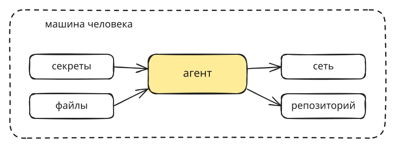
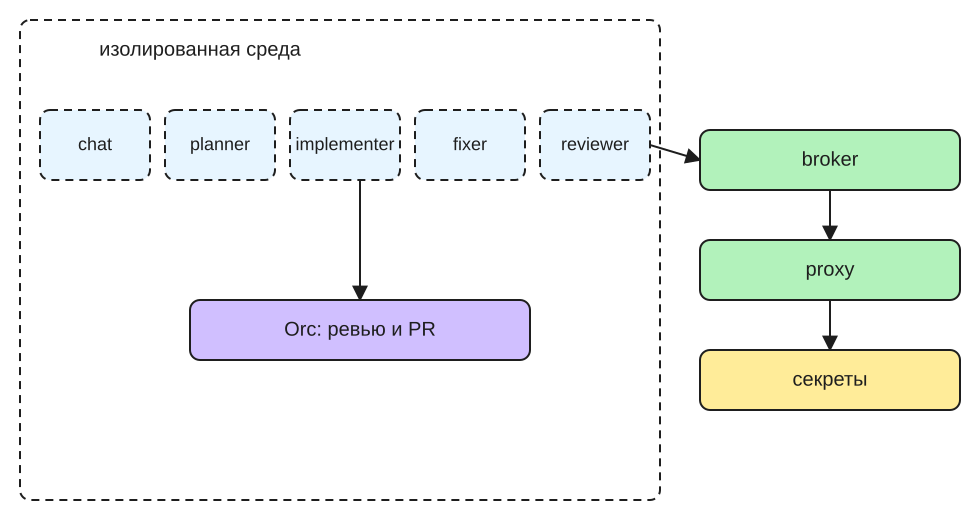

# Orc: агенты, которые ведут агентов

Оркестратор запускает агентов, которые сами читают код, выполняют команды и вносят правки.
Чем больше доступа у агента, тем дороже его ошибка: он может прочитать секрет, переписать чужую работу или отправить изменение мимо проверки.

## Проблема

Один агент на машине человека получает всё, что доступно человеку: файлы, секреты доступа и сеть.
Если в той же среде работают planner, implementer и reviewer, ошибка одного касается всех.
Секрет, который агент прочитал, может попасть в его лог или в команду, которую он запустит.
Проверка тоже слабеет, когда агент, который пишет изменение, сам может его принять.

*Схема 1: один агент видит всё, что видит человек, и сам решает, что делать дальше.*

Помните этого агента с полным доступом?
Дальше каждую его возможность разбирают отдельно: где она живёт, кто держит секреты и кто принимает результат.

## Принципы

Принципы идут от границ к доставке.

### Границы

**Каждая роль работает в своей sandbox.**
Если роли делят одну среду, ошибка в задаче одной роли достаёт файлы другой.
Поэтому planner, implementer, fixer и reviewer получают каждый свой sandbox, и в нём есть только те файлы и та сеть, которые нужны этой роли.

### Секреты

**Секреты лежат вне sandbox.**
Агент, который держит секрет, может вывести его в лог, передать дальше или использовать дольше задачи.
Поэтому секреты держат proxy и broker вне всех sandbox: роль просит действие, broker выполняет его с секретом, а агент секрет не видит.

Остаётся последний шаг, и он самый опасный, потому что там изменение уходит в репозиторий.

### Доставка

**Ревью и доставку делает сам Orc, а не внешний конвейер проверок.**
Если изменение проверяет и принимает другой инструмент, история задачи расходится с историей PR.
Поэтому Orc сам проводит ревью и открывает PR, и вся история задачи собирается в одном месте.

Сравните это с первой картинкой.
Там один агент видел всё, что видит человек.
Здесь каждая роль видит только свою часть задачи, а секреты остаются у broker и proxy.

## Как это устроено в Orc

Orc запускает каждую роль в своей sandbox.
Chat превращает слова человека в задачи, planner делит крупную задачу, а implementer пишет изменение.
Fixer исправляет изменение по выводу упавшей проверки, а reviewer читает его до merge.
Broker и proxy стоят вне всех sandbox и держат секреты: роль просит действие, а broker выполняет его.
Orc сам проводит ревью и открывает PR, и внешний конвейер проверок не нужен.
Это план: схема ещё не построена, и в Orc её пока нет.

*Схема 2: каждая роль работает в своей sandbox, а секреты остаются у broker и proxy вне sandbox.*

## Ресурсы

- [Orc](https://github.com/avi2d/orc): исходный код оркестратора
- [Документация Orc](https://avi2d.github.io/orc/): роли, backlog, beat и run
