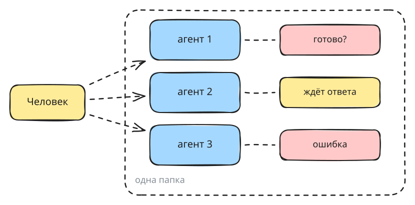
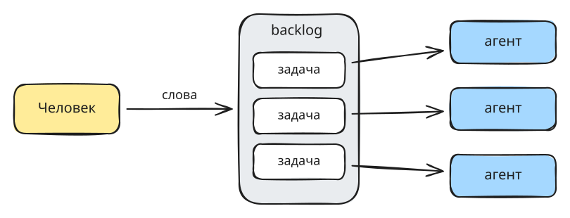
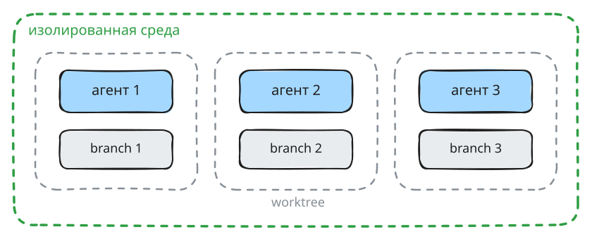
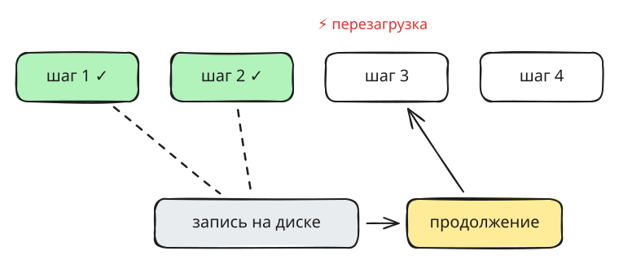

# Оркестрация агентов

Когда агентов становится больше одного, я перестаю писать код и начинаю ходить между окнами терминала.
Я отдаю эту ходьбу оркестратору: он принимает работу словами, сам запускает и проверяет её, а меня зовёт только за решением.

## Проблема

Работа нескольких агентов требует координации и проверки результатов.
Я раздаю три задачи трём агентам, каждому в своём окне.

*Схема 1: три агента делят одну папку и одну машину, и связывает их только человек.*

К середине дня одна задача готова, вторая ждёт ответа, а третья упала на ошибке, и узнать это можно только обходом всех окон.
Два агента правят одни и те же файлы, их тесты идут одновременно, и тест падает из-за соседа, а не из-за своего кода.
А один агент пишет «готово», хотя на его branch не проходит build.

Теперь посмотрите, что на картинке делает человек.
Он держит в голове очередь, раздаёт работу, следит за машиной и проверяет каждый результат.
Дальше я по одной забираю у него эти работы и отдаю программе.

## Принципы

Оркестратор принимает задачи, запускает агентов и проверяет результаты.
Принципы идут по пути задачи: от постановки и запуска через выполнение и проверку к решениям, которые остаются человеку.

### Постановка

Первым с картинки уходит обход окон.

**Работу ставят словами в одном месте.**
Задачи, розданные по окнам, не сведены в один список, и их порядок помнит только человек.
Поэтому я описываю работу обычными словами в одном месте, и каждая задача попадает в backlog, единый список работы.
Мои слова становятся заданием агента дословно, и пересказ не искажает задачу.

*Схема 2: вместо трёх окон один список, куда человек пишет и откуда агенты берут работу.*

**Задача заканчивается проверяемым результатом, а крупная делится на части.**
Задача без названного итога заканчивается словом агента, которое нечем проверить.
Поэтому вид задачи задаёт её итог: ship заканчивается PR, а scout читает код, ничего не меняет и сдаёт отчёт.
Работа крупнее одного PR даёт PR, который нельзя прочитать целиком, поэтому она становится parent, родительской задачей с дочерней на каждую часть, и в конце проверяется целиком.

### Запуск

Теперь в списке лежат задачи, и их нужно кому-то отдать.

**Каждый работник получает роль, а роль задаёт модель и reasoning effort.**
Если вся работа идёт на одной модели, сильная модель тратит лимит на рутину, а слабая получает сложное изменение.
Implementer пишет изменение, fixer исправляет его по выводу упавшей проверки, reviewer читает его и возвращает замечания, и этим ролям нужна сильная модель.
Chat превращает мои слова в задачи, planner делит крупную задачу, и им хватает средней модели, а decider закрывает рутинные вопросы на самой малой.

*Схема 3: модель выбирается под роль, и сильная достаётся тем, кто пишет, исправляет и читает код.*

**Машину и аккаунт выбирает система.**
Когда я сам раскладываю задачи по машинам и аккаунтам, одна машина перегружена, а лимит одного аккаунта кончается, хотя другие свободны.
В момент запуска программа знает свободные места на машинах, их нагрузку и остаток лимита на аккаунтах, а я этого не знаю.
Поэтому выбирает она.

### Выполнение

Вернёмся к первой картинке, к двум агентам в одной папке.

**Каждая задача работает в своём worktree, а система агентов в изолированной среде.**
Два агента в одной папке правят одни и те же файлы, а агент без ограничений читает и меняет всё, что доступно человеку на его машине.
Поэтому каждая задача получает свой worktree на новом branch, а система агентов работает в изолированной среде, отдельной Linux-системе без прав администратора и без доступа к диску машины человека.
На машине человека остаются только задачи, которым она нужна, например работа с симулятором телефона и демонстрации, и каждая из них работает в sandbox.

*Схема 4: общая папка из первой картинки распалась на три worktree, а агентов обводит рамка изолированной среды.*

**Любую работу можно прервать и продолжить.**
Перезагрузка, обрыв связи или вопрос без ответа останавливают сессию, и без записи о сделанном работа начинается заново.
Состояние в памяти процесса пропадает вместе с процессом, поэтому задачи, история и очереди лежат на диске.
Каждый пройденный шаг отмечается в записи, и остановленная задача продолжается с первого шага без отметки.

*Схема 5: после остановки задача не начинается заново, а продолжается с первого шага без отметки.*

### Проверка

Помните агента, который написал «готово» на сломанном branch?

**Готово значит проверено.**
Агент сообщает о завершении и тогда, когда branch пуст, build не проходит или PR не открыт.
Поэтому итог задачи подтверждают новый коммит на branch, пройденные локальные проверки и зелёный CI на открытом PR.
Каждое из этих условий проверяет программа, и ни одно не опирается на слова агента о себе.

*Схема 6: задачу делает готовой не слово агента, а коммит, проверки, ревью и зелёный CI на PR.*

**Ревью делает сильная модель другого семейства.**
Модель склонна хвалить работу своего семейства, а слабая модель не находит ошибок в сложном изменении.
Поэтому reviewer работает на сильной модели другого семейства, чем implementer.
Он читает уже проверенный branch и сверяет его с задачей до merge.

**Важное правило держит программа, а не инструкция.**
Правило из инструкции агент может пропустить или понять по-своему.
Поэтому правило, нарушение которого дорого стоит, я записываю в код, и агент получает отказ вместо напоминания.
Текст инструкции не может ослабить правило из кода.

### Человек

На картинке почти не осталось работы для человека.
Остались решения, и они собираются в attention queue, общую очередь вопросов к decider и ко мне.

**Внимание человека тратится только на решения.**
Агент, который спрашивает обо всём, занимает меня рутиной, а агент, который не спрашивает, действует по догадке.
Поэтому агент задаёт вопрос вместо догадки, а рутинные вопросы закрывает decider по моим правилам.
До меня доходят только приоритеты и критичные и рискованные операции.

*Схема 7: рутинный вопрос закрывает decider, а до человека доходят только критичные операции.*

**Кто делает merge, решают правила проекта и вид задачи.**
Если каждый merge ждёт меня, зелёные PR копятся.
Поэтому правила проекта решают, какой зелёный PR проходит merge без меня, а у задачи, которая заканчивается отчётом, merge нет.
Критичные и рискованные операции ждут меня при любых правилах.

**Состояние видно без захода в сессию агента.**
Без общего dashboard причину ожидания задачи можно узнать только из сессии агента и её лога.
Поэтому каждая ожидающая задача называет причину: нет приоритета, придержал человек, ждёт ответа, ждёт другую задачу, сама является вопросом или нет свободного места.
Закрытая задача, вопрос и оповещение приходят ко мне сами, а логи и отчёты остаются при задаче.

Сравните это с первой картинкой.
Там человек был очередью, диспетчером и проверяющим.
Здесь он ставит задачи словами и принимает решения, а остальное делает программа.

## Как это устроено в Orc

Orc это оркестратор с открытым кодом, построенный по этим принципам.
Схема ниже собирает все картинки статьи в одну.
На машине человека работают chat и задачи в sandbox, которым нужна эта машина, например работа с симулятором телефона и демонстрации.
Backlog, beat, decider и остальные run работают в одной изолированной среде.

*Схема 8: задачу от слов человека до merge ведёт программа, а человек появляется в начале и в attention queue.*

## Ресурсы

Здесь собраны ссылки статьи: интерактивная версия схемы Orc, исходный код и документация Orc, а ещё перечень тезисов всех статей.

- [Как Orc ведёт задачу](https://avi2d.github.io/agent-practice/blog/orchestration-orc.html): интерактивная версия схемы 8
- [Orc](https://github.com/avi2d/orc): исходный код моего оркестратора
- [Документация Orc](https://avi2d.github.io/orc/): устройство chat, backlog, beat, run и очередей
- [Выбранные тезисы](theses.md): перечень тезисов всех статей
