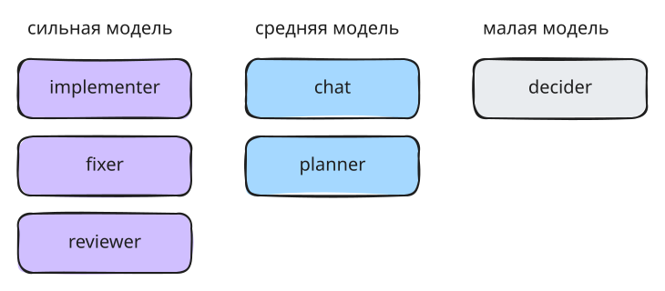
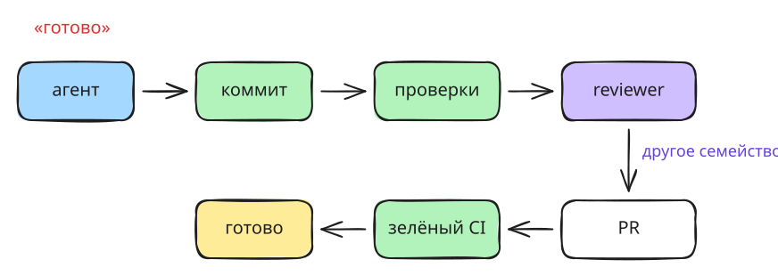
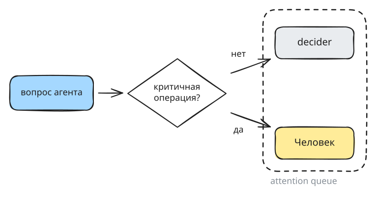
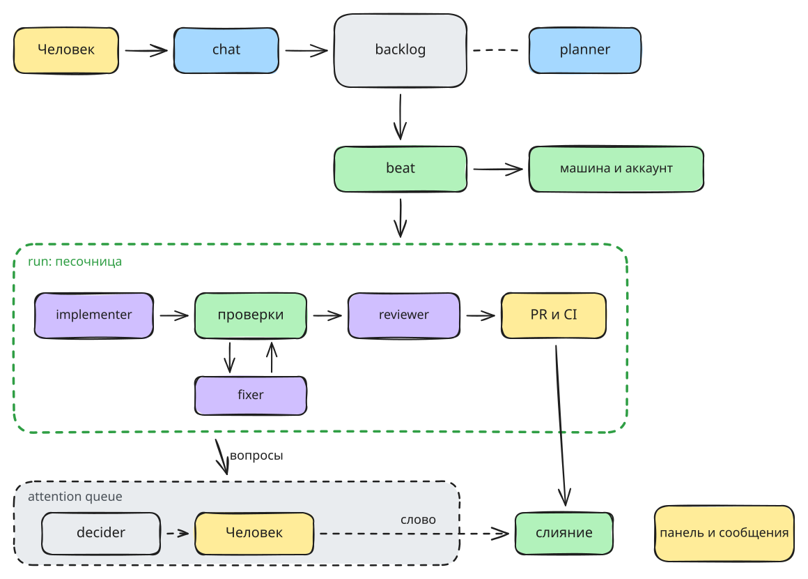

# Оркестрация агентов

Когда агентов становится несколько, человек сам держит очередь задач, раздаёт их, следит за машинами и проверяет каждый результат.
Эта работа отнимает время у решений и ломается, когда никто не помнит, кто что делает.

## Проблема

Работа нескольких агентов требует координации и проверки результатов.
Три задачи раздаются трём агентам, каждому в своём окне терминала.

*Схема 1: три агента делят одну папку и одну машину, и связывает их только человек.*

К середине дня одна задача готова, вторая ждёт ответа, а третья упала на ошибке, и узнать это можно только обходом всех окон.
Два агента правят одни и те же файлы, и тест падает из-за соседа, а не из-за своего кода.
Один агент пишет «готово», хотя на его branch не проходит build.

Проблема в том, что координацию держит человек, и каждый из этих сбоев возникает из-за этого.
Ниже каждый принцип меняет на этой картинке одну вещь.

## Принципы

Оркестратор принимает задачи, запускает агентов и проверяет результаты.
Принципы идут по пути задачи: постановка, запуск, выполнение, проверка и решения, которые остаются человеку.
Элементы системы названы английскими словами, как в коде.
Вот что каждый из них значит:

- **backlog**: единый список работы, куда попадают задачи из слов человека
- **chat**: место, где слова человека превращаются в задачи
- **ship**: вид задачи, который заканчивается PR
- **scout**: вид задачи, который читает код и сдаёт отчёт без изменений
- **parent**: родительская задача, которая делится на дочерние и проверяется целиком
- **planner**: роль, которая делит крупную задачу на части
- **implementer**: роль, которая пишет изменение
- **fixer**: роль, которая исправляет изменение по выводу упавшей проверки
- **reviewer**: роль, которая читает изменение и возвращает замечания
- **decider**: роль, которая закрывает рутинные вопросы по правилам проекта
- **attention queue**: общая очередь вопросов к decider и к человеку

### Постановка

Первым от картинки отказываются в постановке: обход окон заменяется одним списком работы.

**Работу ставят словами в одном месте.**
Задачи, розданные по окнам, не сведены в один список, и их порядок помнит только человек.
Поэтому человек пишет работу обычными словами, и каждая задача попадает в backlog.
Слова человека переходят в задание дословно, без пересказа, который может изменить задачу.

*Схема 2: вместо трёх окон один список, куда человек пишет и откуда агенты берут работу.*

**Задача заканчивается проверяемым итогом, а крупная задача делится на части.**
Задача без названного итога заканчивается словом агента, которое нечем проверить.
Поэтому вид задачи задаёт итог: ship заканчивается PR, а scout читает код и сдаёт отчёт без изменений.
Работа крупнее одного PR делится на дочерние задачи под общей parent, которая проверяется целиком.

### Запуск

Задачи лежат в списке, и теперь нужно решить, какая роль возьмёт каждую.

**Каждый работник получает роль, а роль задаёт модель и reasoning effort.**
Если вся работа идёт на одной модели, сильная тратит лимит на рутину, а слабая получает сложное изменение.
Поэтому implementer, fixer и reviewer получают сильную модель, planner и chat среднюю, а decider самую малую.

*Схема 3: модель выбирается под роль, и сильная достаётся тем, кто пишет, исправляет и читает код.*

**Аккаунт выбирает система.**
Когда человек раскладывает задачи по аккаунтам, лимит одного кончается, хотя другие свободны.
Поэтому в момент запуска система выбирает аккаунт по остатку лимита.
Человек в этот момент не держит эти данные в голове.

### Выполнение

Общая папка с первой картинки ломает выполнение, поэтому каждая задача выполняется отдельно.

**Каждая задача работает в своём worktree, а система агентов в изолированной среде.**
Два агента в одной папке правят одни и те же файлы, а агент без ограничений читает и меняет всё, что доступно человеку на его машине.
Поэтому задача получает свой worktree на новом branch, а система агентов работает в изолированной среде: отдельной Linux-системе без прав администратора, без доступа к диску машины человека и только с узкими ключами доступа.
Задачи, которым нужна машина человека, например работа с симулятором телефона, работают на ней в sandbox.

*Схема 4: общая папка из первой картинки распалась на три worktree, а агентов обводит рамка изолированной среды.*

**Любую работу можно прервать и продолжить.**
Перезагрузка, обрыв связи или вопрос без ответа останавливают сессию, а без записи о сделанном работа начинается заново.
Поэтому задачи, история и очереди лежат на диске, а не в памяти процесса.
Каждый пройденный шаг отмечается в записи, и остановленная задача продолжается с первого шага без отметки.

*Схема 5: после остановки задача не начинается заново, а продолжается с первого шага без отметки.*

### Проверка

Слово агента о завершении не служит доказательством, поэтому проверка опирается на то, что можно проверить.
Помните агента, который написал «готово» на сломанном branch?

**Готово значит проверено.**
Агент сообщает о завершении и тогда, когда branch пуст, build не проходит или PR не открыт.
Поэтому итог задачи подтверждают новый коммит на branch, пройденные локальные проверки и зелёный CI на открытом PR.
Каждое из этих условий проверяет программа, а не слова агента о себе.

*Схема 6: задачу делает готовой не слово агента, а коммит, проверки, ревью и зелёный CI на PR.*

**Ревью делает модель другого семейства.**
Если implementer и reviewer работают на одной модели семейства, reviewer разделяет её слепые места.
Поэтому reviewer работает на сильной модели другого семейства и читает уже проверенный branch до merge.

**Важное правило держит программа, а не инструкция.**
Инструкцию агент может пропустить или понять по-своему.
Поэтому правило, нарушение которого дорого стоит, записано в код, и агент получает отказ вместо напоминания.
Текст инструкции не ослабляет правило из кода.

### Человек

Когда проверки делает программа, человеку остаются решения, и они собираются в attention queue.

**Внимание человека тратится только на решения.**
Агент, который спрашивает обо всём, занимает человека рутиной, а агент, который не спрашивает, действует по догадке.
Поэтому агент задаёт вопрос вместо догадки, а вопросы попадают в attention queue.
Decider закрывает рутинные вопросы по правилам проекта, а до человека доходят приоритеты и критичные и рискованные операции.

*Схема 7: рутинный вопрос закрывает decider, а до человека доходят только критичные операции.*

**Решение о merge принимают правила проекта и вид задачи.**
Если каждый merge ждёт человека, зелёные PR копятся.
Поэтому правила проекта определяют, какой зелёный PR проходит merge без человека, а у задачи, которая заканчивается отчётом, merge нет.
Критичные и рискованные операции ждут человека при любых правилах.

**Состояние видно без захода в сессию агента.**
Без общего dashboard причину ожидания можно узнать только из сессии агента и её лога.
Поэтому каждая ожидающая задача называет причину: нет приоритета, её придержал человек, она ждёт ответа или другой задачи, сама является вопросом или нет свободного места.
Закрытая задача, вопрос и оповещение приходят человеку сами, а логи и отчёты остаются при задаче.

Сравните это с первой картинкой.
Там человек был очередью, диспетчером и проверяющим.
Здесь он ставит задачи словами и принимает решения, а остальное делает программа.

## Как это устроено в Orc

Orc это оркестратор с открытым кодом, и он построен по этим принципам.
На машине человека работают chat и задачи в sandbox, которым нужна эта машина.
Backlog, beat, decider и каждый run, которому эта машина не нужна, работают в одной изолированной среде.
Схема ниже собирает все картинки статьи в одну.

- **beat**: планировщик, который запускает готовые задачи и закрывает задачи, чей run закончился
- **run**: одно выполнение задачи

*Схема 8: задачу от слов человека до merge ведёт программа, а человек появляется в начале и в attention queue.*

## Ресурсы

Ссылки ведут на интерактивную схему Orc, его исходный код и документацию.

- [Как Orc ведёт задачу](https://avi2d.github.io/agent-practice/blog/orchestration-orc.html): интерактивная версия схемы 8
- [Orc](https://github.com/avi2d/orc): исходный код Orc
- [Документация Orc](https://avi2d.github.io/orc/): устройство chat, backlog, beat, run и очередей
