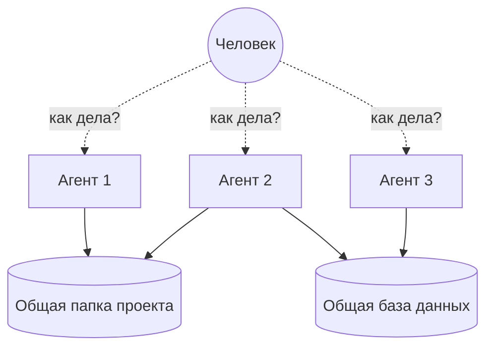
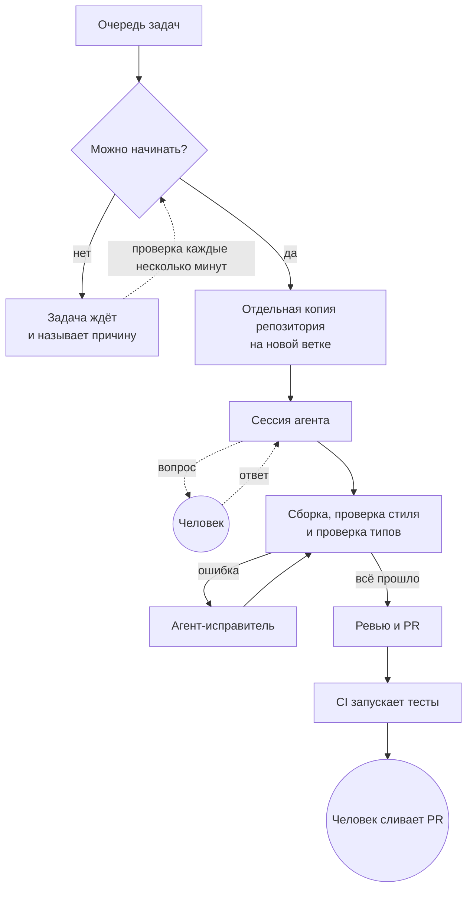
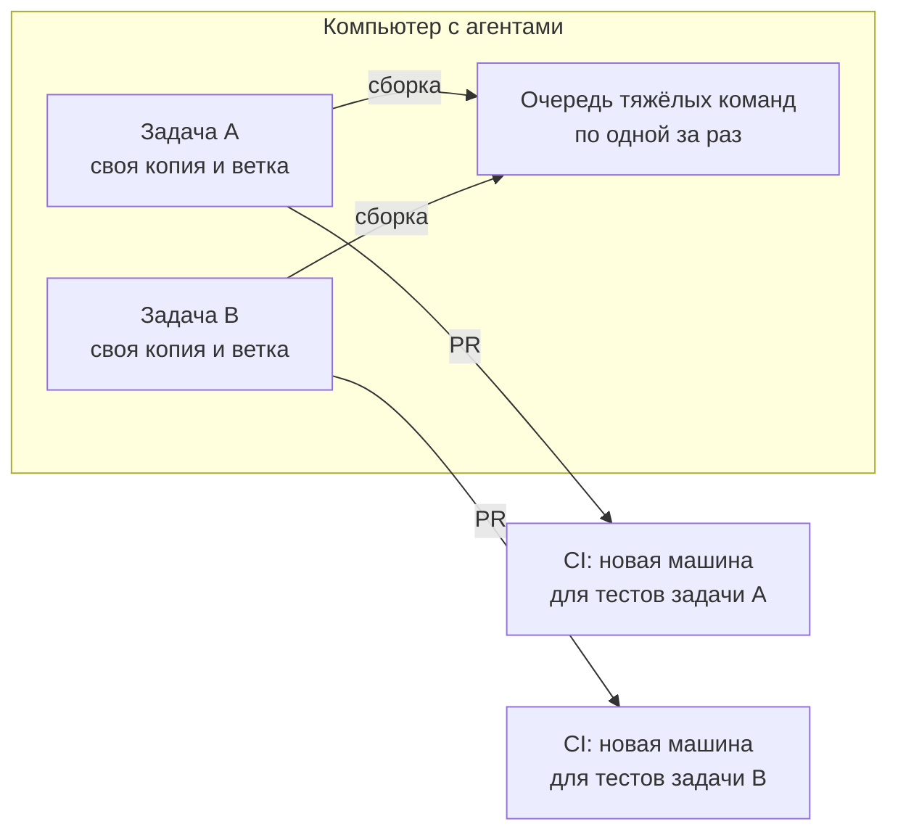
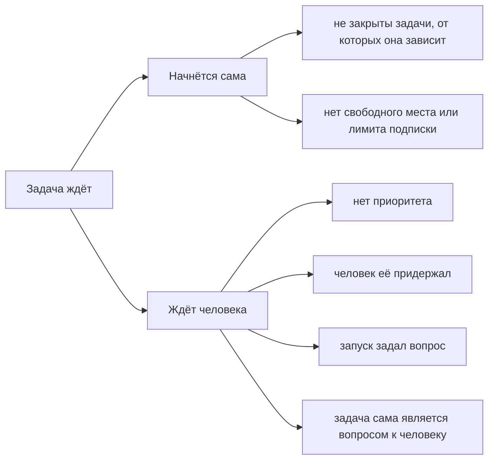

# Оркестрация и параллельная работа

Один кодовый агент справляется с задачей сам, а пять агентов сразу требуют диспетчера.
Без него человек весь день сверяет, какой агент работает, какой ждёт и где лежит готовый результат.
Дальше по порядку: в чём проблема, каких целей добивается автор, какие тезисы из них следуют и как их выполняет его инструмент Orc.

## Проблема

Кодовым агентом называют программу на основе языковой модели, которая сама читает код, запускает команды и вносит правки.
Над одной задачей агент работает долго: читает файлы, правит код, запускает проверки.
Пока он занят, человек может отдать следующую задачу второму агенту, потом третьему.

Допустим, утром вы раздали пять задач.
К обеду одна готова, вторая задала вопрос и ждёт ответа, третья упала, а две ещё идут.
Чтобы это узнать, приходится обойти все пять окон и вспомнить, что в каком из них происходит.
Каждая такая сверка отрывает от работы, ради которой задачи и раздавали.

Вторая беда тише: параллельные задачи мешают друг другу.
Два агента в одной папке правят одни и те же файлы.
Тесты двух задач пишут в одну базу данных и падают из-за соседа, а не из-за своего кода.
Человек ищет ошибку, которой в коде нет.

*Схема 1: без оркестрации человек сам опрашивает каждого агента, а агенты делят одну папку и одну базу данных.*

## Цели

Из двух бед автор выводит три цели.

- **Одно место.** Человек запускает задачи, видит, чего ждёт каждая, и забирает результат в одном месте.
- **Задачи не мешают друг другу.** Упавший тест означает ошибку в коде задачи, а не помеху от соседней.
- **Итог можно проверить.** По каждой задаче видно, что делал агент, почему задача стоит и откуда взялся результат.

Каждой цели служат свои тезисы.

| Цель | Тезисы |
| --- | --- |
| Одно место | T01, T02, T03 |
| Задачи не мешают друг другу | C10, C11 |
| Итог можно проверить | O01, O02 |

## Тезисы

Каждый тезис открывает метка, которая говорит, на чём он держится.
Позиция автора ещё не измерена, правило автор соблюдает в работе, а устройство описывает, как работает Orc.
Источники каждого тезиса собраны в конце статьи в разделе «Ресурсы».

### Оркестрация собирает задачи в одном месте `T01`

**Позиция автора: оркестрация нужна, чтобы управлять запуском, ожиданием и результатом задач из одного места.**
Оркестрацией называют запуск нескольких агентов, учёт очереди задач и сбор результатов в одном месте.
Это прямой ответ на первую беду: вместо пяти окон у человека одна очередь.
Задача из очереди начинается сама, когда для неё всё готово, и сама сообщает итог.
Решение при этом остаётся за человеком, потому что задача без приоритета не начинается совсем.
Исследований, которые сравнивали бы работу с оркестрацией и без неё, автор не нашёл, поэтому тезис остаётся его позицией.

### У каждой задачи своя сессия агента `T02`

**Устройство: каждую задачу ведёт отдельная сессия агента, чтобы у задачи были свой ход работы, свои вопросы к человеку и свой итог.**
Сессией называют одну непрерывную работу агента над задачей, с журналом действий и итогом.
Это не разовый вопрос к модели: в сессии агент сам читает код, вызывает команды и проверяет себя.
Пользу такой среды показала работа SWE-agent, опубликованная на конференции NeurIPS 2024.
Агент с удобными командами для работы с репозиторием решил с первой попытки 12,5% задач набора SWE-bench.
Лучшая на тот момент система, которая не действовала в среде, а только писала ответ, решала 3,8%.
Отдельная сессия на задачу даёт ещё и порядок: вопросы и итог одной задачи не смешиваются с чужими.
Из работы SWE-agent следует, что агенту нужна среда для действий, но не следует, что каждой задаче нужен отдельный процесс.

### Субагенты для защиты контекста не нужны `T03`

**Позиция автора: современные модели хорошо пишут и запускают программы, поэтому субагенты для защиты контекста автору не нужны.**
Контекстом называют весь текст, который модель видит в момент ответа: задачу, файлы и историю сессии.
Субагентом называют вспомогательного агента, которого основной агент запускает с отдельным контекстом, чтобы тот выполнил часть работы и вернул короткий ответ.
Так основной агент бережёт свой контекст от лишнего текста.
Проблема настоящая, и её измерили Liu и соавторы в журнале TACL в 2024 году.
В их опытах модели хуже находили сведения в середине длинного контекста, чем в начале или в конце.
Автор решает её иначе: модель сама пишет программу для повторяемой работы, запускает её и читает только итог.
Это свойство проверила работа CodeAct с конференции ICML 2024.
Агенты, которые действовали кодом на Python, решали в ней до 20 процентных пунктов больше задач, чем агенты с действиями в виде JSON или текста.
Авторы CodeAct проверили 17 моделей на двух наборах задач.
У многоагентных систем при этом свои сбои.
Разбор MAST с конференции NeurIPS 2025 собрал 1642 записи работы семи многоагентных систем, и доля неудачных запусков в них составила от 41% до 86,7%.
Ни одна из этих работ не сравнивает субагентов с одним агентом на задачах автора, поэтому тезис остаётся позицией.

### У каждой задачи своя копия файлов `C10`

**Правило: каждая параллельная задача работает в своей копии файлов, а общие ресурсы делят по очереди или копируют, чтобы задачи не мешали друг другу.**
Своя копия файлов снимает спор за папку, и агенты не правят одни и те же файлы.
Но копия файлов не даёт отдельной базы данных.
Общий ресурс ломает тесты и в обычных проектах, без всяких агентов.
Luo и соавторы в 2014 году разобрали 201 исправление нестабильных тестов в 51 открытом проекте фонда Apache.
Нестабильным называют тест, который на одном и том же коде то проходит, то падает.
Среди тестов, которые зависят от порядка запуска, 47% подвела зависимость от внешнего ресурса, например файла или базы данных.
Чаще всего такие тесты чинили, очищая общее состояние между запусками: так исправили 14 из 19 разобранных случаев.
Эти данные собраны задолго до кодовых агентов и не говорят, как часто такое случается у параллельных агентов.

### Тесты запускает CI `C11`

**Правило: тесты запускает CI в отдельной среде, чтобы упавший тест означал ошибку в коде, а не помеху от соседней задачи.**
CI называют сервер, который запускает проверки на каждое предложенное изменение.
CI на GitHub обычно даёт каждому запуску проверок новую виртуальную машину, и соседей у теста там нет.
Исключение составляют самые маленькие машины с одним процессором, которые делят одну виртуальную машину.
По данным Luo и соавторов, три причины дали 77% из 161 исправления, причину которых удалось установить.
Это ожидание асинхронной операции, одновременная работа потоков и зависимость от порядка тестов.
Одно ожидание асинхронной операции дало 45%.
Например, тест ждёт ответа сервиса две секунды и падает, если перегруженный соседями компьютер ответил позже.
Проверить это на своём проекте можно так: запустите одни и те же проверки сначала по одной, потом одновременно, не меняя код, и сравните итоги.

### Видно, почему задача ждёт `O01`

**Устройство: у каждой ожидающей задачи Orc называет причину ожидания, чтобы человек видел, какая задача начнётся сама, а какая ждёт его.**
Список из пяти задач со словом «ждёт» бесполезен, если непонятно, какая из них ждёт именно вас.
Поэтому Orc пишет у каждой задачи, чего она ждёт, и делит причины на две группы, как показывает схема 4 в разделе «Решение».
Документация Orc описывает устройство, но не измеряет, быстрее ли человек замечает задачу, которая ждёт его.

### Запись запуска хранит всё вместе `O02`

**Устройство: запись запуска хранит задачу, ход сессии и отчёт вместе, чтобы итог можно было проверить, а сбой разобрать.**
Когда агент закончил, человеку мало слова «готово».
Ему нужно видеть, что агент делал, какие команды падали и на чём он основал своё решение.
Запись запуска хранит всё это в одном месте.
Такие записи нужны и исследователям.
Авторы разбора MAST прочитали больше 150 полных записей запусков, в среднем больше 15 тысяч строк каждая, чтобы найти, где система ошиблась.
Запись позволяет проверить, откуда взялся результат, но не заменяет саму проверку.

## Решение: как работает Orc

Orc это инструмент автора, который ведёт очередь задач для агентов, запускает их и показывает ход работы в одном чате.
Его код открыт, и описание ниже взято из его документации.

### Путь задачи

*Схема 2: путь одной задачи от очереди до слияния, где всё до PR делает Orc, а сливает изменение только человек.*

Каждая задача хранится в очереди как текстовый файл, и её текст становится заданием для агента.
Каждые несколько минут Orc проверяет очередь и запускает задачи, для которых выполнены пять условий:

- у задачи есть приоритет, который дал человек
- человек её не придержал, и вопрос по ней не ждёт ответа
- все задачи, от которых она зависит, закрыты
- на одном из компьютеров есть свободное место для её проекта
- у подписки на агента остался лимит

Сколько осталось от лимита каждой подписки, показывает другой инструмент автора, Subquo.
Задачу, которая сама является вопросом к человеку, Orc не запускает никогда.

Когда условия выполнены, Orc создаёт отдельную копию репозитория на новой ветке, и агент не трогает рабочую папку человека.
Веткой называют отдельную линию изменений, которая не трогает основной код, пока её не примут.
Пока агент работает, Orc следит за ним:

- останавливает агента, который долго ничего не пишет и не запускает команд
- сообщает человеку, если одна и та же команда падает снова и снова
- после серии таких неудач ставит запуск на паузу и спрашивает человека, продолжать ли
- даёт агенту задать человеку вопрос, чтобы тот не угадывал

Когда агент закончил, Orc запускает сборку, проверку стиля кода и проверку типов.
Если проверка не прошла, Orc отдаёт текст ошибки агенту-исправителю, а если несколько попыток подряд не помогли, запуск заканчивается неудачей и PR не открывается.
PR называют запрос на изменение: предложение влить ветку в основной код, которое можно обсудить и проверить.
Запуск считается успешным, только когда агент сообщил о завершении, на ветке есть новое изменение, проверки прошли и PR открыт.
Слить PR может только человек.

### Как задачи не мешают друг другу

*Схема 3: у каждой задачи своя копия файлов, сборки идут по одной, а тесты уходят в CI на чистую машину.*

Своя копия файлов и своя ветка у каждой задачи выполняют правило C10.
Тяжёлые команды, такие как сборки и проверки кода, Orc пропускает через очередь по одной, чтобы несколько агентов не перегрузили компьютер.
Тесты репозитория агент на общем компьютере не запускает вовсе: Orc отказывает в такой команде и оставляет тесты CI, как требует правило C11.
Выбирая компьютер для задачи, Orc берёт тот, где больше свободных мест.
Компьютер, у которого нагрузка выше заданного предела или очередь тяжёлых команд длинная, новых задач не берёт.
Эти показатели говорят о загрузке компьютера, но не о том, остались ли тесты надёжными.

### Почему задача ждёт

*Схема 4: шесть причин ожидания делятся на две группы, и человеку достаточно следить за второй.*

Orc различает шесть причин ожидания и у каждой ожидающей задачи называет её причину, как требует тезис O01.
Две причины проходят сами: закроются задачи, от которых она зависит, или освободится место.
Четыре причины ждут человека, и пока он не ответит, задача не сдвинется.
Страница задач в Orc показывает у каждой задачи, чего она ждёт, кто должен действовать, и её PR.

### Запись запуска

Для каждого запуска Orc хранит текст задачи, журналы, сессию агента и итоговый отчёт, как требует тезис O02.
Любой шаг запуска можно открыть отдельно и прочитать его вывод.
Остановленный запуск продолжается на той же ветке: Orc пропускает шаги, которые запись отмечает пройденными, а агент продолжает прежнюю сессию.

## Ресурсы

### Инструменты автора

- [Orc](https://github.com/avi2d/orc): очередь задач и запуск агентов
- [Subquo](https://github.com/avi2d/subquo): остаток лимитов подписок на агентов

### Документация Orc

Ссылки ведут на версию документации от 24 ноября 2026 года.

- [Направление Orc](https://github.com/avi2d/orc/blob/52ce89f52dd9af826ed558ccdc6274e8fc9f51d5/VISION.md#L3-L5): цикл от очереди до итога
- [Только человек сливает изменения](https://github.com/avi2d/orc/blob/52ce89f52dd9af826ed558ccdc6274e8fc9f51d5/VISION.md#L17)
- [Пять условий запуска задачи](https://github.com/avi2d/orc/blob/52ce89f52dd9af826ed558ccdc6274e8fc9f51d5/docs/concepts/beat.md#L14-L26)
- [Выбор компьютера для задачи](https://github.com/avi2d/orc/blob/52ce89f52dd9af826ed558ccdc6274e8fc9f51d5/docs/concepts/beat.md#L35-L41)
- [Вопросы и ответы во время работы](https://github.com/avi2d/orc/blob/52ce89f52dd9af826ed558ccdc6274e8fc9f51d5/docs/concepts/beat.md#L45-L52)
- [Шесть причин ожидания](https://github.com/avi2d/orc/blob/52ce89f52dd9af826ed558ccdc6274e8fc9f51d5/docs/concepts/backlog.md#L39-L54)
- [Что такое запуск](https://github.com/avi2d/orc/blob/52ce89f52dd9af826ed558ccdc6274e8fc9f51d5/docs/concepts/run.md#L8-L9)
- [Отдельная копия репозитория](https://github.com/avi2d/orc/blob/52ce89f52dd9af826ed558ccdc6274e8fc9f51d5/docs/concepts/run.md#L13-L16)
- [Как Orc следит за агентом](https://github.com/avi2d/orc/blob/52ce89f52dd9af826ed558ccdc6274e8fc9f51d5/docs/concepts/run.md#L26-L31)
- [Когда запуск успешен](https://github.com/avi2d/orc/blob/52ce89f52dd9af826ed558ccdc6274e8fc9f51d5/docs/concepts/run.md#L33-L40)
- [Запись запуска](https://github.com/avi2d/orc/blob/52ce89f52dd9af826ed558ccdc6274e8fc9f51d5/docs/concepts/run.md#L45-L50)
- [Продолжение остановленного запуска](https://github.com/avi2d/orc/blob/52ce89f52dd9af826ed558ccdc6274e8fc9f51d5/docs/concepts/run.md#L52-L55)
- [Проверки, исправления и CI](https://github.com/avi2d/orc/blob/52ce89f52dd9af826ed558ccdc6274e8fc9f51d5/docs/concepts/checks-and-review.md#L14-L21)
- [Очередь тяжёлых команд](https://github.com/avi2d/orc/blob/52ce89f52dd9af826ed558ccdc6274e8fc9f51d5/docs/run/heavy-queue.md#L5-L7)
- [Тесты только в CI](https://github.com/avi2d/orc/blob/52ce89f52dd9af826ed558ccdc6274e8fc9f51d5/docs/run/heavy-queue.md#L67-L69)
- [Страница задач с причиной ожидания](https://github.com/avi2d/orc/pull/305)

### Исследования

- [Yang и соавторы, SWE-agent, NeurIPS 2024](https://arxiv.org/abs/2405.15793): агент со средой для действий решает 12,5% задач SWE-bench
- [Liu и соавторы, Lost in the Middle, TACL 2024](https://aclanthology.org/2024.tacl-1.9/): модели хуже находят сведения в середине длинного контекста
- [Wang и соавторы, CodeAct, ICML 2024](https://arxiv.org/abs/2402.01030): действия кодом против действий в виде JSON и текста на 17 моделях
- [Cemri и соавторы, MAST, NeurIPS 2025](https://arxiv.org/abs/2503.13657): 14 видов сбоев многоагентных систем по 1642 записям
- [Luo и соавторы, An Empirical Analysis of Flaky Tests, FSE 2014](https://doi.org/10.1145/2635868.2635920): причины нестабильных тестов в 51 проекте
- [Документация GitHub о машинах для CI](https://docs.github.com/en/actions/concepts/runners/github-hosted-runners): новая виртуальная машина на каждый запуск

### Автор и соседние статьи

- [Рабочая страница автора об оркестрации](../topics/orchestration.md)
- [Словарь терминов](reader-guide.md#словарь)
- [Выбранные тезисы](theses.md)
- [Автономия и контроль](autonomy.md)
- [Проверки качества и мутации](quality.md)
- [Контекст и сжатие](context.md)
