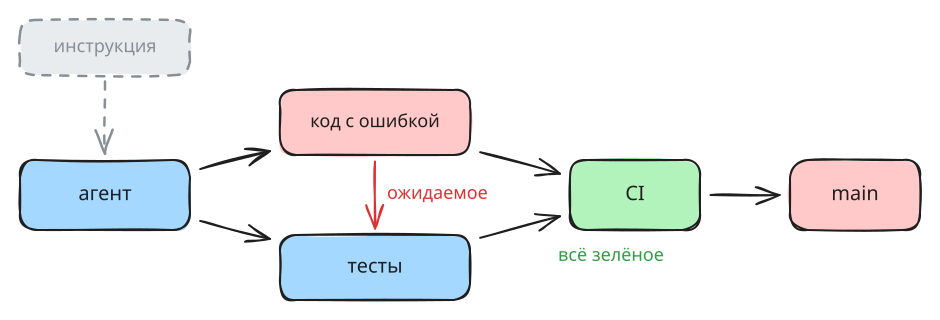
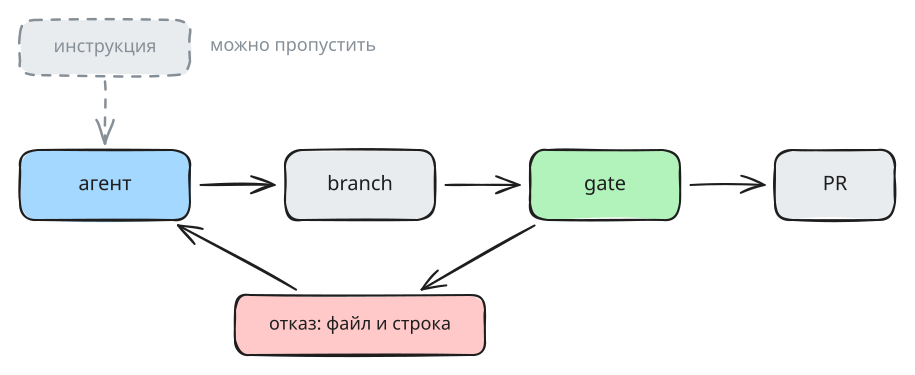
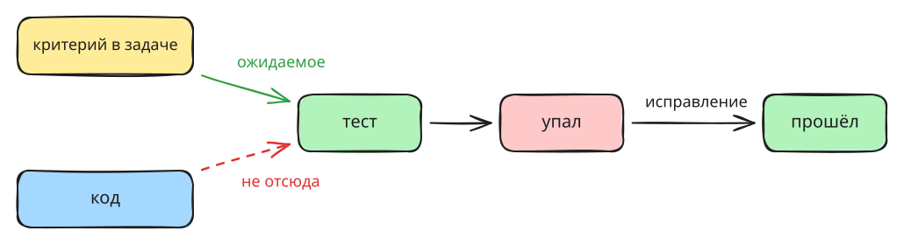
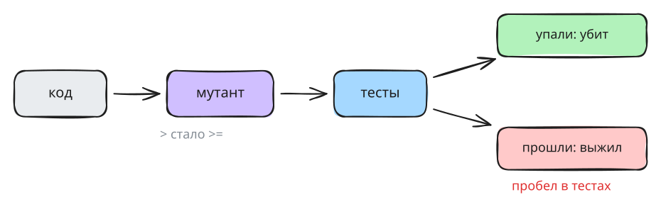
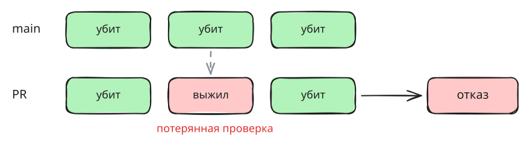
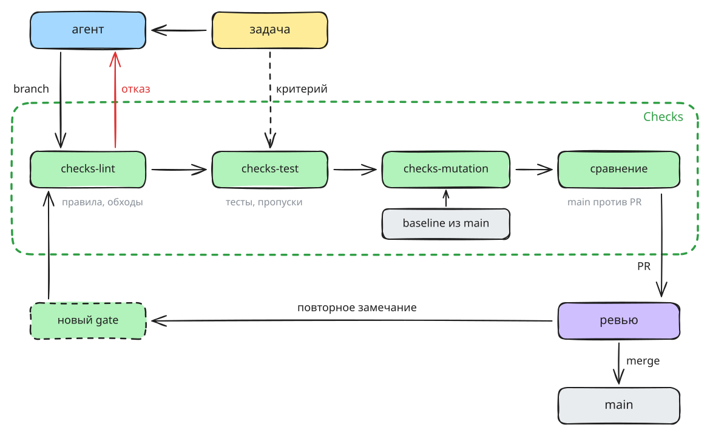

# Проверки качества и мутации

Агент пишет код и тесты к нему в одной сессии, и зелёный CI подтверждает только то, что они согласны друг с другом.
Проверка даёт основание для merge, когда известно, какое нарушение она ловит, и когда она его хотя бы раз поймала.
Поэтому правила держит программа, ожидаемый результат приходит не из проверяемого кода, а сами тесты проверяет мутация.

## Проблема

Посмотрите на эту картинку, она ещё понадобится.

*Схема 1: агент сам пишет код и тесты к нему, поэтому зелёный CI пропускает ошибку в main.*

Агент получает задачу и сдаёт PR: код, тесты к нему и зелёный CI.
Ожидаемые значения в тестах он взял из собственного кода, поэтому тесты повторяют его ошибку.
Правило из инструкции он пропустил, а проверку, которая мешала, отключил комментарием.
Покрытие при этом полное: каждая строка выполнилась, но её поломку не заметил бы ни один тест.
Ошибка уходит в main с зелёной отметкой.

На картинке три места, где зелёный цвет ничего не значит: правило, ожидаемый результат и сами тесты.
Дальше каждое из них получает того, кто его проверяет.

## Принципы

### Правила

Первым идёт правило, которое агент пропустил.

**Правило, которое можно проверить, держит программа.**
Правило из инструкции агент может пропустить или понять по-своему, а ревью заметит это, только если само помнит правило.
Поэтому проверяемое правило становится gate, программой, которая идёт на каждом изменении и отказывает нарушению.
Gate держит только записанное свойство: запрет циклов в зависимостях не говорит, разумно ли зависимости устроены.

**Gate отказывает, а не исправляет.**
Проверка, которая сама правит изменение, выпускает код, который никто не писал и не проверял.
Поэтому gate только отказывает и называет файл, строку и то, что нужно исправить.
Исправляет агент, и его исправление снова проходит каждый gate.

*Схема 2: инструкцию агент может пропустить, а gate возвращает ему отказ с файлом и строкой.*

**Обход проверки тоже нарушение.**
Агент, у которого gate упал, идёт к зелёному кратчайшим путём: отключает правило комментарием, пропускает тест или ослабляет ожидание.
Поэтому комментарий, который отключает правило, запрещён, а число старых исключений может только уменьшаться.
Пропущенный тест называет причину, а тест, вынесенный из общего прогона, к сроку возвращается или удаляется.

**Новое правило начинается с изменённых строк.**
Правило, которое в первый день отказывает всему репозиторию, блокирует чужую работу, и его отключают.
Поэтому gate судит только строки, которых коснулось изменение, а нетронутый код проходит.
Цена этого решения медленный переход: старое нарушение живёт до первой правки в его строке.

### Ожидаемый результат

Правило теперь держит программа, но тесты на первой картинке всё ещё списаны с кода.

**Build, тест и проверка на месте отвечают на разные вопросы.**
Зелёный build принимают за работающий продукт, хотя он говорит только, что артефакт собрался.
Тест говорит, что поведение совпало с ожидаемым на заданном входе.
Что результат работает там, где им пользуются, показывает только проверка на месте: открытая страница, запущенная команда, установленный пакет.

**Ожидаемый результат берут не из проверяемого кода.**
Тест, списанный с реализации, закрепляет её ошибку: код и тест согласны, и оба неверны.
Поэтому ожидаемое значение приходит извне: из критерия приёмки, записанного в задаче до работы, из спецификации или из внешнего контракта.
В исследовании EvalPlus тестов к 164 задачам стало в 80 раз больше, и доля принятых решений 26 моделей упала на величину до 28,9%.
Это задачи на отдельные функции, а не работа агента в репозитории, но механизм тот же: слабый тест принимает неверный код.

**Тест сначала должен упасть.**
Тест, который ни разу не падал, не показал, что умеет падать.
Поэтому тест запускают до исправления и видят отказ по нужной причине, а после исправления видят, что он прошёл.
Отказ из-за ошибки в запуске самого теста не считается.

*Схема 3: ожидаемое значение приходит в тест из задачи, а не из кода, и до исправления тест падает.*

### Тесты

Остался последний вопрос первой картинки: кто проверяет сами тесты.

**Тесты проверяет мутация, а не покрытие.**
Покрытие показывает, что строка выполнилась, а не что тест заметит её поломку.
Мутация вносит в код намеренную ошибку, например меняет `>` на `>=`, и запускает тесты на изменённой копии, мутанте.
Мутант, с которым тесты прошли, выжил, и он показывает поведение, которое никто не проверяет.
Исследование на почти 15 миллионах мутантов промышленного кода разобрало 1 502 исправленные ошибки высокого приоритета.
Для 1 043 из них нашёлся мутант, который выживал до исправления и погибал от теста на эту ошибку.
Это разбор уже исправленных ошибок, а не число ошибок, которые мутация предотвратила.

*Схема 4: мутант, с которым тесты упали, убит, а выживший мутант показывает пробел в тестах.*

**Выжившего мутанта разбирают.**
Процент убитых мутантов не говорит, какой из выживших стоит теста.
Если мутант нарушает контракт, появляется тест с примером этого нарушения.
Если мутант на всех допустимых входах ведёт себя как исходный код, он равнозначен ему, и тест не нужен.

**Gate считает потерянные проверки, а не процент.**
Порог по общему проценту выполняют тестами на простой код, а потерянная проверка прячется за новыми мутантами.
Поэтому gate сравнивает main и PR по каждому мутанту.
Мутант, убитый в main и выживший в PR, это потерянная проверка, и она останавливает изменение.

*Схема 5: процент почти не изменился, но один мутант был убит в main и выжил в PR, и это отказ.*

### Скорость

Каждая проверка удлинила путь изменения до merge.

**Проверка смотрит только на то, чего коснулось изменение.**
Медленная проверка задерживает каждого агента, и её начинают запускать реже или пропускать.
Поэтому на PR идут только те gate, тесты и мутанты, до которых дотягивается diff, а результат для нетронутого кода берётся из прогона на main.
Полный прогон остаётся запасным вариантом и идёт по расписанию.

### Ревью

После программ изменение читает ревью.

**Ревью проверяет то, что программа не выразит.**
Ревью, занятое именами и форматированием, пропускает сломанный контракт.
Механические правила уже держит gate, поэтому ревью смотрит за границу изменённого файла: кто вызывает изменённый интерфейс и сохранилось ли обещанное поведение.
Оно же сверяет, что тесты проверяют критерий задачи, а не повторяют написанный код.

**Повторное замечание становится правилом в программе.**
Замечание, которое ревью делает второй раз, показывает правило, которое живёт только в памяти.
Если ошибку можно запретить типом, меняют тип, и результат со статусом «готово» без данных перестаёт собираться.
Остальное становится новым gate, и следующее изменение получает отказ, а не замечание.

Сравните это с первой картинкой.
Там зелёный CI значил, что код агента согласен с тестами агента.
Здесь правило держит gate, ожидаемое значение приходит из задачи, а тесты показали на мутантах, что замечают поломку.
Зелёная отметка теперь говорит, что именно проверено.

## Как это устроено в Checks

Checks это мой набор проверок с открытым кодом, построенный по этим принципам.
Репозиторий получает новое правило обновлением одной зависимости, а не копированием настроек.
Схема ниже собирает все картинки статьи в одну.

*Схема 6: отказ возвращается агенту с файлом и строкой, а повторное замечание ревью возвращается в Checks новым gate.*

## Ресурсы

- [Как Checks проверяет изменение](https://avi2d.github.io/agent-practice/blog/quality-checks.html): интерактивная версия схемы 6
- [Checks](https://github.com/avi2d/checks): исходный код набора проверок
- [Документация Checks](https://github.com/avi2d/checks/tree/main/docs): описание каждого gate и общих настроек
- [Is Your Code Generated by ChatGPT Really Correct?](https://arxiv.org/abs/2305.01210v3): исследование EvalPlus о тестах, которые принимают неверный код
- [Does mutation testing improve testing practices?](https://arxiv.org/abs/2103.07189v1): исследование связи мутантов с исправленными ошибками в промышленном коде
