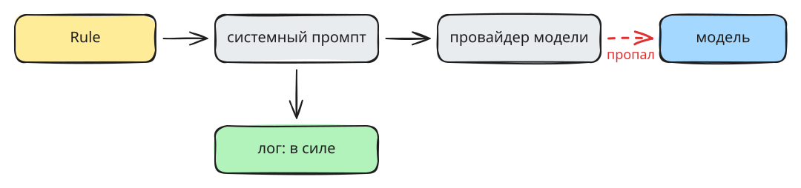
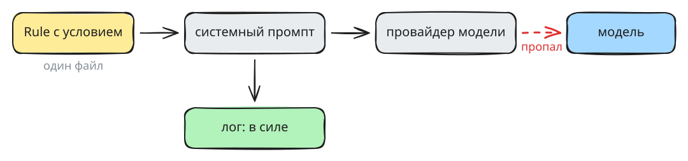
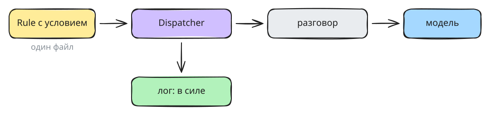
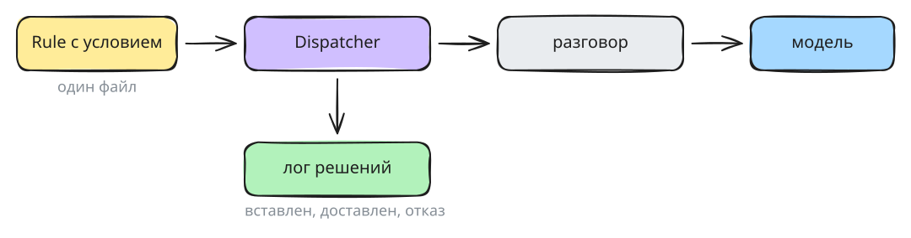
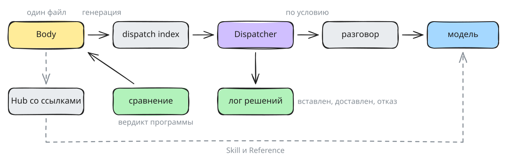

# Навыки и инструкции для агентов

Инструкция для агента может не дойти до модели, а запись при этом покажет, что она работает.
Каждая инструкция записана один раз, система доставляет её, когда работа требует, и записывает, что передано в разговор.

## Проблема

Цель: записывать инструкции в одном месте и доставлять их в каждую среду запуска автоматически.
Разные виды инструкций доставляются по-разному.
Набор инструкций нужно настраивать под каждую модель.

Инструкции бывают трёх видов:

- **Rule** срабатывает сам, когда выполнено его условие: например, при изменении миграции агент получает правило проверить её.
- **Skill** лежит в библиотеке и загружается, когда его вызывает человек: например, «собрать релиз».
- **Reference** агент читает по имени, когда ему нужен фон: например, описание формата конфигурации.

Этим целям мешают три проблемы.
Правило записывают в нескольких копиях, и они расходятся.
Правило без условия действует всегда или нигде.
Правило может пропасть по пути к модели, а лог этого не покажет.

Следующая схема показывает, как правило теряется по пути к модели.

*Схема 1: правило пропало по пути к модели, а лог считает его работающим.*

Правило для агентов лежало в системном промпте, и один провайдер модели при сборке промпта выбрасывал его без ошибки.
Лог при этом показывал, что правило в силе.
Модель правила не видела и работала так, будто его нет.
Никто этого не замечал, потому что в логе тихая потеря выглядит как работа правила.

На картинке видно одно правило, которое пропало по пути к модели, а лог пишет, что оно в силе.
Дальше каждое из них получает замену.

## Принципы

Инструкция проходит путь от написания до проверки.
На каждом шаге этого пути сначала назван сбой, а потом средство, которое его устраняет.

### Написание

**Один источник инструкций, а набор на каждую модель выбирается в одной конфигурации.**
Каждая модель получает свой набор из него.
Набор задаётся одним файлом, и его не копируют вручную по файлам.

**Инструкция записана один раз и живёт в одном месте.**
Две копии одного правила расходятся, агент получает старую, и никто не видит разницы.
Поэтому каждая инструкция лежит одним файлом, а каталог, который видит модель, держит на него только ссылку, без копии текста.

**Инструкция называет одну работу и условие, при котором она действует.**
Правило без условия действует во всех сессиях или ни в одной, и оба исхода ломают работу.
Условие проверяет программа, например по типу изменённого файла, и модель не решает за неё, когда правило нужно.

**То, что может проверить программа, пишет программа.**
Текст, который модель может прочесть и не выполнить, не даёт проверки, а программа даёт.
Поэтому правило переходит в проверку, а в тексте остаётся причина, и это решение записано в библиотеке skills.

**Небольшой набор навыков даёт больше, чем исчерпывающий.**
В SkillsBench 2026 года на 87 задачах и 18 сочетаниях модели и среды запуска навыки подняли долю решённых задач на величину от 4,1 до 25,7 процентного пункта, смотря по сочетанию.
Наборы из двух или трёх модулей дали прирост 19,0 процентного пункта, а исчерпывающие 0,7.
Эти наборы шли на разных группах задач, так что причина разницы не доказана.

*Схема 2: правило записано один раз и с условием, но путь к модели остался прежним.*

Инструкция записана, и теперь её нужно доставить туда, где работа её требует.

### Загрузка

**Инструкция, которая относится к классу работы, срабатывает по условию, а не по памяти модели.**
Dispatcher проверяет условие и вставляет правило, а модель не выбирает, читать ли его.
Библиотека skills держит такие правила отдельно от навыков, которые человек вызывает сам.

**Правило доходит до модели как сообщение в разговоре при каждом её вызове.**
Системный промпт собирает провайдер модели, и правило в нём может пропасть, как на первой картинке.
Поэтому правило идёт в разговор, а не в системный промпт, и это решение записано в библиотеке skills.

**Dispatcher проверяет, что передал в разговор ровно то, что записал.**
Правило, записанное как вставленное, но не пришедшее в разговор, помечается как сломанное и называется по имени.
Тихая потеря без такой проверки выглядит как работа правила.

**Инструкция, которая не нужна задаче, не занимает место в каталоге.**
Описание каждого правила тратит место в каждой сессии, поэтому правило, которое срабатывает по условию, в каталог не попадает.

*Схема 3: правило идёт в разговор, а не через сборку промпта, и доходит до модели.*

Помните правило, которое пропало по пути к модели?
Теперь правило приходит в разговор само, а лог по-прежнему пишет только «в силе».

### Актуальность

**Правка действует с момента, который система называет.**
Генерация копирует текст правила в dispatch index, файл, из которого Dispatcher берёт правила, поэтому новая сессия видит правку только после генерации.
Текст навыка меняется сразу, без генерации, и порядок правки правила записан в README библиотеки skills.

**Лог записывает каждое правило, которое Dispatcher вставил, передал в разговор или назвал причиной отказа.**
Правило, которое тихо выключилось, выглядит как работающее, и только лог их различает.

**Инструкцию меняет сравнение, а не впечатление.**

*Схема 4: лог пишет, что случилось с правилом, а не только то, что оно в силе.*

## Как это устроено в skills

Библиотека skills хранит инструкции для агентов в одном месте, и каждая записана как Body: папка с файлом в открытом формате SKILL.md.
Файл selection.toml задаёт набор на каждую модель: профиль по умолчанию даёт списки для неизвестных моделей, а каждый другой профиль называет точные имена моделей и правила, которые добавляет или убирает.
Генерация отказывается, если Body не найден или модель заявлена двумя профилями.
Dispatcher в каждой среде запуска проверяет условия Rule, вставляет правило в разговор и записывает в лог каждое своё решение.
Правка текста Skill или Reference видна сразу, а правка Rule попадает в сессию после генерации и новой сессии.
Правило проходит сравнение с той же задачей без него, и вердикт выносит программа.

*Схема 5: путь инструкции от Body до модели, где каждое решение Dispatcher записано в лог.*

## Ресурсы

- [Как skills доставляет инструкцию](https://avi2d.github.io/agent-practice/blog/skills-skills.html): интерактивная версия схемы 5
- [skills](https://github.com/avi2d/skills): исходный код библиотеки инструкций, ссылки на документацию skills ведут на один коммит
- [Почему этот репозиторий существует](https://github.com/avi2d/skills/blob/ef4c37dbd60b3e96b592c9f855d436bb0bb247ae/docs/why.md): почему инструкции держатся в одном месте, а не в навыках каждой среды запуска
- [Глоссарий skills](https://github.com/avi2d/skills/blob/ef4c37dbd60b3e96b592c9f855d436bb0bb247ae/docs/glossary.md): значения Body, Rule, Skill, Reference, Hub и Dispatcher
- [Правило доходит до модели в разговоре](https://github.com/avi2d/skills/blob/ef4c37dbd60b3e96b592c9f855d436bb0bb247ae/docs/adr/0002-a-rule-reaches-the-model-in-the-conversation.md): решение о месте, куда попадает правило
- [Ограничение, которое может проверить программа, пишется программой](https://github.com/avi2d/skills/blob/ef4c37dbd60b3e96b592c9f855d436bb0bb247ae/docs/adr/0024-a-constraint-a-program-can-decide-is-written-as-a-program.md): решение о проверках
- [Запись сравнения](https://github.com/avi2d/skills/blob/ef4c37dbd60b3e96b592c9f855d436bb0bb247ae/docs/adr/0063-a-sweep-commits-its-record-and-a-bare-sweep-measures-the-rule-least-recently-swept.md): решение о том, что запись сравнения хранится в библиотеке
- [Набор на каждую модель](https://github.com/avi2d/skills/blob/ef4c37dbd60b3e96b592c9f855d436bb0bb247ae/docs/adr/0073-a-profile-is-a-complete-model-selection.md): решение о наборе на каждую модель
- [Правка правила в следующей сессии](https://github.com/avi2d/skills/blob/ef4c37dbd60b3e96b592c9f855d436bb0bb247ae/README.md#get-an-edited-rule-into-the-next-session): порядок правки и генерации
- [SkillsBench: Benchmarking How Well Agent Skills Work Across Diverse Tasks](https://arxiv.org/abs/2602.12670v4): сравнение задач с навыками и без них
