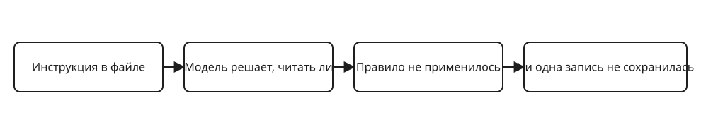
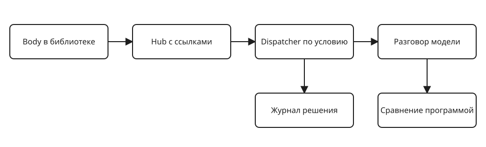

# Навыки и инструкции для агентов

Инструкция, которую агент должен вспомнить сам, часто не попадает в работу: модель решает, читать ли её.
Мой ответ: каждая инструкция записана один раз, система доставляет её, когда работа требует, и записывает, что именно доставлено.

## Проблема

Посмотрите на эту картинку, она ещё понадобится.

*Схема 1: инструкция, которую модель должна вспомнить, не применяется, и никто об этом не узнаёт.*

Правило в файле инструкций работает, только если модель открыла этот файл.
Если модель его не открыла, ни одна запись этого не покажет, и правило числится в инструкциях, хотя не применилось.

Библиотека skills объясняет причину: навык загружается, только когда модель вспомнила его загрузить.
Она передаёт документацию одной из сред запуска агентов, где сказано, что модели делают это не всегда.

## Принципы

Инструкция, которую нужно доставить, проходит путь от написания до проверки, и каждый сбой на этом пути назван раньше средства от него.

### Написание

**Инструкция записана один раз и живёт в одном месте.**
Две копии одного правила расходятся, агент получает старую, и никто не видит разницы.
Поэтому каждая инструкция лежит одним файлом, а каталог, который видит модель, держит на него только ссылку, без копии текста.

**Инструкция называет одну работу и условие, при котором она действует.**
Правило без условия действует во всех сессиях или ни в одной, и оба исхода ломают работу.
Условие проверяет программа, например по типу изменённого файла, и модель не решает за неё, когда правило нужно.

**То, что может проверить программа, пишет программа.**
Текст, который модель может прочесть и не выполнить, не даёт проверки, а программа даёт.
Поэтому правило переходит в проверку, а в тексте остаётся причина, и это решение записано в [ADR 0024](https://github.com/avi2d/skills/blob/ef4c37dbd60b3e96b592c9f855d436bb0bb247ae/docs/adr/0024-a-constraint-a-program-can-decide-is-written-as-a-program.md).

**Короткий навык обгоняет полный свод.**
В SkillsBench наборы с не больше чем тремя модулями дали больший результат, чем большие и исчерпывающие наборы.
Исследование сравнивает наборы, а не отдельную инструкцию, поэтому вывод относится к наборам.

Инструкция записана, и теперь её нужно доставить туда, где работа её требует.

### Загрузка

**Инструкция, которая относится к классу работы, срабатывает по условию, а не по памяти модели.**
Диспетчер проверяет условие и вставляет правило, а модель не выбирает, читать ли его.
Библиотека skills держит такие правила отдельно от навыков, которые человек вызывает сам.

**Правило доходит до модели как сообщение в разговоре при каждом её вызове.**
Системный промпт собирает провайдер модели, и в одном провайдере правила из него пропадали без следа.
Журнал при этом говорил, что правило в силе, а модель его не видела.
Поэтому правило идёт в разговор, а не в системный промпт, и это [решение](https://github.com/avi2d/skills/blob/ef4c37dbd60b3e96b592c9f855d436bb0bb247ae/docs/adr/0002-a-rule-reaches-the-model-in-the-conversation.md) записано в библиотеке.

**Диспетчер проверяет, что передал модели ровно то, что записал.**
Правило, записанное как вставленное, но не пришедшее в разговор, помечается как сломанное и называется по имени.
Тихая потеря без такой проверки выглядит как работа правила.

**Инструкция, которая не нужна задаче, не занимает место в каталоге.**
Описание каждого правила тратит место в каждой сессии, поэтому правило, которое срабатывает по условию, в каталог не попадает.

Помните правило, которое никто не открыл?
Теперь правило приходит в разговор само, и остаётся понять, что делать, когда его текст меняется.

### Актуальность

**Правка действует с момента, который система называет.**
Текст правила копируется в индекс при генерации, поэтому новая сессия видит правку только после неё.
Текст навыка меняется сразу, без генерации, и порядок правки правила записан в [README библиотеки](https://github.com/avi2d/skills/blob/ef4c37dbd60b3e96b592c9f855d436bb0bb247ae/README.md#get-an-edited-rule-into-the-next-session).

**Журнал записывает каждое правило, которое вставлено, доставлено или отказано.**
Правило, которое тихо выключилось, выглядит как работающее, и только журнал их различает.

**Инструкцию меняет сравнение, а не впечатление.**
В SkillsBench одни и те же задачи шли с навыками и без них, и прирост менялся от 4,1 до 25,7 процентного пункта между сочетаниями моделей и сред запуска, по версии статьи v4.
Запись каждого сравнения хранится в библиотеке вместе с условиями, при которых оно шло.
Правило, которое не дало прироста, выключается, и это моя позиция, а не вывод исследования.

### Границы

**Инструкция не даёт полномочий.**
Текст навыка говорит агенту, как работать, и не открывает ему секрет, сеть или запись в основной branch.
Границу задаёт изоляция: одно изолированное пространство вокруг всей системы агентов, узкие отзывные логины и защищённый основной branch.
Отдельный sandbox на каждого агента по умолчанию не ставится.
Это моя позиция, которую внешнее исследование не подтверждает.

Сравните с первой картинкой.
Там инструкция ждала, пока её вспомнят, и пропуск не оставлял следа.
Здесь условие решает, когда правило нужно, каждая доставка записана, а правка действует с момента, который система называет.

## Как это устроено в skills

Библиотека skills хранит инструкции для агентов в одном месте, и каждая записана как Body: файл SKILL.md и его папки в формате Agent Skills.
Вид инструкции задаёт её запуск: Rule срабатывает по условию, Skill вызывает человек, а Reference агент читает по имени.
Dispatcher в каждой среде запуска проверяет условия Rule, вставляет правило в разговор и записывает в журнал каждое своё решение.
Hub устроен как плоский каталог ссылок на Skill и Reference, и копий текста в нём нет.
Правка текста Skill или Reference видна сразу, а правка Rule попадает в сессию после генерации и новой сессии.
Правило проходит сравнение с той же задачей без него, и вердикт выносит программа.

*Схема 2: путь инструкции от Body до разговора модели, где каждое решение записано в журнал.*

## Ресурсы

- [skills](https://github.com/avi2d/skills): исходный код библиотеки инструкций, все ссылки этой статьи ведут на один коммит
- [Почему этот репозиторий существует](https://github.com/avi2d/skills/blob/ef4c37dbd60b3e96b592c9f855d436bb0bb247ae/docs/why.md): почему инструкции держатся в одном месте, а не в навыках каждой среды запуска
- [Глоссарий skills](https://github.com/avi2d/skills/blob/ef4c37dbd60b3e96b592c9f855d436bb0bb247ae/docs/glossary.md): значения Body, Rule, Skill, Reference, Hub и Dispatcher
- [Правило доходит до модели в разговоре](https://github.com/avi2d/skills/blob/ef4c37dbd60b3e96b592c9f855d436bb0bb247ae/docs/adr/0002-a-rule-reaches-the-model-in-the-conversation.md): решение о месте, куда попадает правило
- [Ограничение, которое может проверить программа, пишется программой](https://github.com/avi2d/skills/blob/ef4c37dbd60b3e96b592c9f855d436bb0bb247ae/docs/adr/0024-a-constraint-a-program-can-decide-is-written-as-a-program.md): решение о проверках
- [Запись sweep](https://github.com/avi2d/skills/blob/ef4c37dbd60b3e96b592c9f855d436bb0bb247ae/docs/adr/0063-a-sweep-commits-its-record-and-a-bare-sweep-measures-the-rule-least-recently-swept.md): решение о том, что запись сравнения хранится в библиотеке
- [Правка правила в следующей сессии](https://github.com/avi2d/skills/blob/ef4c37dbd60b3e96b592c9f855d436bb0bb247ae/README.md#get-an-edited-rule-into-the-next-session): порядок правки и генерации
- [SkillsBench: Benchmarking How Well Agent Skills Work Across Diverse Tasks](https://arxiv.org/abs/2602.12670v4): сравнение задач с навыками и без них
- [Agent Skills](https://agentskills.io/specification): стандарт формата SKILL.md
