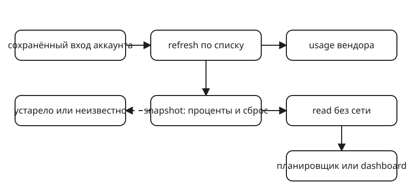

# Subquo: сколько квоты осталось на каждом аккаунте

Агент выбирает аккаунт перед каждой задачей, и от остатка квоты зависит, закончит ли он её.
Subquo читает остаток квоты всех названных аккаунтов и записывает его в один файл, который может прочитать любой инструмент.

## Проблема

Квота это остаток лимита платной подписки на агентов, и она кончается посреди работы.
Аккаунт с пустой квотой выглядит так же, как аккаунт со свободной, пока задача на нём не упадёт.
Каждый провайдер показывает остаток в своём интерфейсе, и собрать их в одно место можно только вручную.
Ручной сбор устаревает раньше, чем задача кончается.
Инструмент, который выбирает аккаунт, видит одно число и не знает, когда оно обновится.

Помните аккаунт, который выглядел свободным?
Принципы ниже описывают, как читать квоту, чтобы такого не случилось.

## Принципы

Принципы разделены по вопросам: что читает программа, что считается свободным и что ждёт.

### Что читает программа

**Отчёт не выбирает аккаунт.**
Инструмент, который читает квоту, начинает решать за остальных, и каждый читатель теряет свои правила.
Subquo показывает для каждого окна лимита процент остатка и время сброса.
Выбор, пороги и порядок траты остаются у планировщика или dashboard.

**Вход читается, но не принадлежит программе.**
Программа, которая пишет вход, может переписать его одновременно с другой, и работающий агент выйдет из системы.
Subquo читает вход в памяти, просит инструмент вендора обновить его и никогда не записывает и не переключает.
Вход снова задаёт владелец аккаунта.

**Секрет не выходит за пределы чтения.**
Токен, который попал в лог, файл или тест, уже не вернуть.
Вывод содержит только перечисленные поля и безопасные коды ошибок.
Поэтому токен, ответ вендора и путь к входу не попадают ни в снимок, ни в лог, ни в тест.
Цена этого правила: при сбое чтения видно меньше деталей.

### Что считается свободным

**Неизвестное не считается полным.**
Старое или пропавшее значение, принятое за свободную квоту, отправляет задачу на пустой аккаунт.
Значение годится как довод для выбора, только пока оно свежее.
Цена: иногда мимо проходит аккаунт, на котором ещё есть квота.

**Запас считают по самому малому лимиту.**
Сложение окон прячет то, которое кончится первым.
Запас аккаунта для задачи равен самому малому из лимитов, которые на неё действуют.

**Каждый аккаунт назван.**
Инструмент, который угадывает аккаунт по умолчанию, может прочитать чужой вход и показать чужую квоту.
Subquo читает только аккаунты, которые назвал явный список.
Цена: список каждая машина ведёт вручную.

### Что ждёт

**Чтение не ждёт провайдера.**
Инструмент, который ждёт ответа вендора, блокировку или запрос пароля, останавливает выбор, а с ним и задачу.
Команда read печатает последний полный снимок без сети.
Цена: снимок может быть так же стар, как интервал обновления.

Сравните с проблемой: выбор теперь идёт по свежему снимку, а не по догадке.

## Как это устроено в Subquo

Subquo читает квоту каждого названного аккаунта и записывает новый снимок целиком.
Поэтому прерванное обновление не оставляет наполовину записанный файл.
Для каждого аккаунта снимок держит процент остатка по окнам, время сброса и время, когда значение получили.
Вход Subquo берёт только для запроса к вендору и никогда его не записывает.
Устаревшее или неизвестное значение выводится с его возрастом, и выбор по нему не делается.
Планировщик или dashboard читает этот файл и сам решает, какой аккаунт взять.

*Схема 1: Subquo пишет один снимок с остатками, а выбор аккаунта остаётся за читателем файла.*

## Ресурсы

- [Subquo](https://github.com/avi2d/subquo): исходный код программы, которая читает остаток квоты
- [Видение Subquo](https://github.com/avi2d/subquo/blob/main/VISION.md): для чего Subquo нужен и от чего он отказывается
- [Дизайн снимка квоты](https://github.com/avi2d/subquo/blob/main/docs/design.md): формат снимка, правила свежести и открытые вопросы
- [Документация Subquo](https://github.com/avi2d/subquo#readme): установка и проверка изменения
