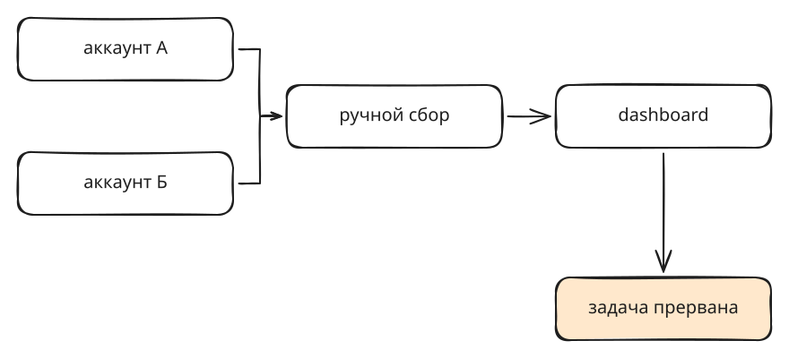

# Subquo: сколько квоты осталось на каждом аккаунте

Человек или планировщик выбирает аккаунт перед каждой задачей, и от остатка квоты зависит, закончит ли агент её.
Subquo читает остаток квоты всех названных аккаунтов и записывает `snapshot`, общий файл, который может прочитать любой инструмент.

## Проблема

Квота это остаток лимита платной подписки на агентов, и она кончается посреди работы.

*Схема 1: ручной сбор не даёт свежих данных для выбора аккаунта.*

Аккаунт с пустой квотой выглядит так же, как аккаунт со свободной, пока задача на нём не упадёт.
Каждый провайдер показывает остаток в своём интерфейсе, и собрать их в одно место можно только вручную.
Ручной сбор устаревает раньше, чем задача кончается.
Инструмент, который выбирает аккаунт, видит одно число и не знает, когда оно обновится.

Помните аккаунт, который выглядел свободным?
Принципы ниже описывают, как читать квоту, чтобы такого не случилось.

## Принципы

Принципы разделены по вопросам: что читает программа, что считается свободным и что ждёт.

### Что читает программа

Сначала ручной сбор заменяется отчётом, который не распоряжается ни аккаунтами, ни входом в них.

**Отчёт не выбирает аккаунт.**
Инструмент, который читает квоту, начинает решать за остальных, и каждый читатель теряет свои правила.
Subquo показывает для каждого окна лимита процент остатка и время сброса.
Выбор, пороги и порядок траты остаются у планировщика или dashboard.

**Вход читается, но не принадлежит программе.**
Программа, которая пишет вход, может переписать его одновременно с другой, и работающий агент выйдет из системы.
Subquo читает вход в памяти, просит инструмент вендора обновить его и никогда не записывает и не переключает.
Вход снова задаёт владелец аккаунта.

**Секрет не выходит за пределы чтения.**
Токен, который попал в лог, файл или тест, уже не вернуть.
В `snapshot`, лог и тест попадают только разрешённые поля и безопасные коды ошибок, без токена, ответа вендора и пути к входу.
Цена этого правила: при сбое чтения видно меньше деталей.

### Что считается свободным

Отчёт собран, но старое значение всё ещё может выглядеть как свободная квота.
Дальше меняется то, какие данные годятся для выбора.

**Неизвестное не считается полным.**
Старое или пропавшее значение, принятое за свободную квоту, отправляет задачу на пустой аккаунт.
Значение годится как довод для выбора, только пока оно свежее.
Цена: иногда мимо проходит аккаунт, на котором ещё есть квота.

**Запас считают по самому малому лимиту.**
Сложение окон прячет то, которое кончится первым.
Запас аккаунта для задачи равен самому малому из лимитов, которые на неё действуют.

**Каждый аккаунт назван.**
Инструмент, который угадывает аккаунт по умолчанию, может прочитать чужой вход и показать чужую квоту.
Subquo читает только аккаунты, которые назвал явный список.
Владелец ведёт список вручную.

### Что ждёт

Свежесть проверяется при выборе, а ожидание ответа вендора остаётся у команды сбора `refresh`.

**Чтение не ждёт провайдера.**
Инструмент, который ждёт ответа вендора, блокировку или запрос пароля, останавливает выбор, а с ним и задачу.
Команда `read` печатает последний полный `snapshot` без сети.
Его данные могут быть так же стары, как интервал между вызовами `refresh`.

Сравните с первой картинкой.
Там ручной сбор вёл к выбору вслепую и прерванной задаче.
Теперь `read` даёт полный `snapshot` без ожидания вендора, а для выбора годятся только свежие известные значения.

## Как это устроено в Subquo

Команда `refresh` читает квоту каждого названного аккаунта и заменяет `snapshot` целиком.
Поэтому прерванный `refresh` не оставляет наполовину записанный файл.
Для полученных значений `snapshot` хранит процент остатка по окнам, время сброса и время, когда значение получили.
Вход Subquo берёт только для запроса к вендору и никогда его не записывает.
Для устаревшего наблюдения `stale` виден возраст, для недоступного `unavailable` видна причина, а для выбора не годится ни одно.
Планировщик или dashboard получает этот файл через `read` и сам решает, какой аккаунт взять.

*Схема 2: `refresh` заменяет ручной сбор, `snapshot` хранит данные вместе с их состоянием, а `read` отдаёт их для выбора без сети.*

## Ресурсы

- [Путь данных Subquo](https://avi2d.github.io/agent-practice/blog/subquo.html): интерактивная версия схемы 2
- [Subquo](https://github.com/avi2d/subquo): исходный код программы, которая читает остаток квоты
- [Видение Subquo](https://github.com/avi2d/subquo/blob/main/VISION.md): для чего Subquo нужен и от чего он отказывается
- [Дизайн Subquo](https://github.com/avi2d/subquo/blob/main/docs/design.md): формат `snapshot`, правила свежести и открытые вопросы
- [Документация Subquo](https://github.com/avi2d/subquo#readme): установка и проверка изменения
